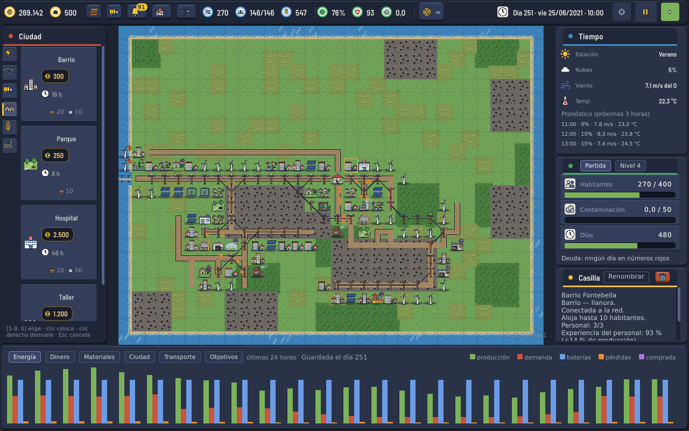
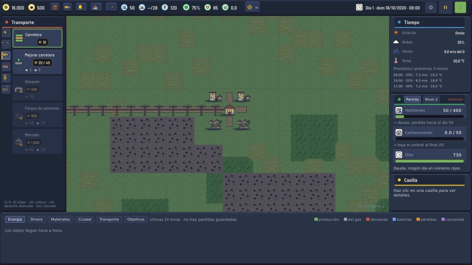

  

🇮🇹 [Italiano](README.it.md) · 🇬🇧 [English](README.md) · 🇩🇪 [Deutsch](README.de.md) · 🇫🇷 [Français](README.fr.md) · 🇪🇸 Español

# ⚡ Voltvale: Energy Grid Tycoon

**Gestionas la red eléctrica de una pequeña ciudad que crece.** Cada hora la ciudad necesita energía: poca de
noche, mucha por la tarde. Construye centrales, plantas solares, parques eólicos y baterías, conéctalo todo con
líneas eléctricas y carreteras, encuentra gente que trabaje en ellas, turno tras turno, da de comer a todos, lleva
mercancías y materiales en camión sin atascar el tráfico, y haz crecer tu aldea hasta **400 habitantes en dos años
de juego**, sin apagones continuos, sin deudas y sin ahogarla en contaminación.

Un juego original de **Marco Scarlino**. Gratuito. Sitio oficial: **[voltvale.it](https://voltvale.it/es/)**.

## Tráiler

**[▶ Ver el tráiler (1 minuto)](https://scrnetto.github.io/energy-grid-tycoon-releases/trailer/voltvale-trailer-es.mp4)** ·
también en [italiano](https://scrnetto.github.io/energy-grid-tycoon-releases/trailer/voltvale-trailer-it.mp4),
[inglés](https://scrnetto.github.io/energy-grid-tycoon-releases/trailer/voltvale-trailer-en.mp4),
[alemán](https://scrnetto.github.io/energy-grid-tycoon-releases/trailer/voltvale-trailer-de.mp4) y
[francés](https://scrnetto.github.io/energy-grid-tycoon-releases/trailer/voltvale-trailer-fr.mp4)

> **Estado: en desarrollo (alpha).** Se puede jugar de principio a fin, pero aún faltan muchas cosas y algunas
> pueden no funcionar. Cada aviso ayuda: consulta
> [Informar de un problema o proponer una idea](#informar-de-un-problema-o-proponer-una-idea).

## Juega ya en el navegador

**[▶ Juega a Voltvale en el navegador](https://scrnetto.github.io/energy-grid-tycoon-releases/)**: no hay que
instalar nada. Necesitas un navegador reciente (Chrome, Firefox, Edge, Safari) en un ordenador con ratón y
teclado, o una tableta: **toque = clic, toque largo = clic derecho**. Haz clic en el juego antes de usar el
teclado. Tus partidas guardadas se quedan en el navegador que uses.
En un teléfono en **horizontal**, el juego pasa a una disposición pensada para teléfonos (todavía en pruebas:
mira [Problemas conocidos](#problemas-conocidos)).

**También en itch.io: [marcoscarlino.itch.io/voltvale](https://marcoscarlino.itch.io/voltvale)**, donde puedes
jugar en el navegador, descargar el juego para cada sistema y dejar un comentario. Las partidas guardadas en el
navegador en itch.io son independientes de las de aquí.

## Descargar el juego

Todas las versiones están en la página **[Releases](../../releases)** y en
**[itch.io](https://marcoscarlino.itch.io/voltvale)**. Descarga el archivo de tu sistema de la última versión:

| Sistema | Archivo | Cómo abrirlo |
|---|---|---|
| **Windows** 10/11 (64 bits) | `Voltvale-<versión>-windows.zip` | Extrae el zip y abre `Voltvale.exe` |
| **macOS** 12 o posterior | `Voltvale-<versión>-macos.zip` | Extrae el zip y abre `Voltvale.app` |
| **Linux** (64 bits) | `Voltvale-<versión>-linux.zip` | Extrae el zip y ejecuta `Voltvale` |
| **Android** 8 o posterior (tableta o teléfono) | `Voltvale-<versión>-android.apk` | Abre el archivo en el dispositivo e instálalo (ver abajo) |

### La primera vez que lo abres

El juego no está firmado con un certificado de pago, así que tu sistema puede avisarte de que viene de un
desarrollador desconocido. Es normal en los juegos independientes.

- **Windows**: si aparece «Windows protegió su PC», haz clic en **Más información** y luego en **Ejecutar de todas
  formas**.
- **macOS**: si aparece que la app «no se puede abrir porque no se puede verificar el desarrollador», haz **clic
  derecho en la app → Abrir** y confirma con **Abrir**. Solo hace falta la primera vez. Si el Mac dice que la app
  «está dañada», abre el Terminal en la carpeta del zip y escribe `xattr -cr Voltvale.app`.
- **Linux**: si no arranca, haz ejecutable el archivo con `chmod +x Voltvale`.
- **Android**: el juego no está en Play Store. Descarga el `.apk` en el dispositivo y ábrelo; la primera vez Android
  pide permitir las instalaciones desde el navegador o el gestor de archivos («Instalar aplicaciones
  desconocidas»). Play Protect puede avisar de que la app es desconocida: elige instalarla de todas formas. Para
  actualizar, instala el nuevo `.apk` encima del anterior. En pantalla táctil: **toque = clic, toque largo = clic
  derecho**, dos dedos para mover el mapa y para hacer zoom.

**Comprobar la descarga (opcional).** Cada versión tiene un archivo `SHA256SUMS.txt` con la huella de cada zip.
En Linux se comprueba con `sha256sum -c --ignore-missing SHA256SUMS.txt`, en macOS con
`shasum -a 256 -c SHA256SUMS.txt`.

### Requisitos

- Una pantalla de al menos 1280×800, o un teléfono en horizontal.
- Ratón y teclado, o una pantalla táctil (tableta o teléfono, versión web o Android).
- Unos 200 MB de espacio libre.
- Cualquier tarjeta gráfica de los últimos 10 años: las integradas también sirven.

## Cómo se juega

El juego se abre con el **menú de inicio**: **Nueva partida**, donde eliges el nombre de la ciudad y la dificultad
(consulta [Nueva partida](#nueva-partida)), o **Continuar** para retomar tu última partida guardada. La partida empieza el **domingo 18 de octubre de 2020** a las 8 y arranca **en pausa**: pulsa
**Espacio** para que corra el tiempo. A velocidad 1× una hora de juego dura un segundo, y puedes acelerar a 2× y
4×. Las estaciones siguen el calendario: empiezas en otoño, y en invierno los días son más cortos y el cielo está
más nublado. La barra de arriba muestra el día de la partida, el día de la semana, la fecha y la hora, por ejemplo
«Día 1 · dom 18/10/2020 · 08:00».

- **Objetivo**: llegar a **400 habitantes** con la contaminación **por debajo del límite** en **2 años**. Después de
  la victoria puedes **seguir jugando**, sin límite de tiempo.
- **Derrota**: si tu dinero se queda en números rojos **30 días seguidos**, o si se acaban los 2 años antes de la
  victoria.
- **El ayuntamiento crece**: de **aldea** a **pueblo**, **villa** y **ciudad**, cumpliendo pequeños objetivos. Cada
  nivel desbloquea edificios nuevos: consulta
  [Niveles del ayuntamiento y objetivos](#niveles-del-ayuntamiento-y-objetivos).
- **Se construye con cuadrillas**: un edificio nuevo es primero una **obra**, y funciona cuando una cuadrilla termina
  el trabajo. Consulta [Obras y cuadrillas](#obras-y-cuadrillas).
- **La red**: cada edificio debe estar conectado al **ayuntamiento**. Las **líneas eléctricas** salen del
  ayuntamiento y lo prolongan, también en diagonal. Un edificio está conectado si toca el ayuntamiento, una línea u
  otro edificio ya conectado: un grupo de edificios pegados está conectado si uno de ellos toca la red.
- **Las carreteras**: además de la electricidad, cada edificio debe tocar con un lado una **carretera conectada al
  ayuntamiento** (las líneas eléctricas no la necesitan). Consulta [Carreteras y tráfico](#carreteras-y-tráfico).
- **Demanda y energía**: la ciudad consume poco de noche y mucho por la tarde, hacia las 19. Si la energía no
  alcanza, ni siquiera con la que se compra fuera, hay **apagón**: los habitantes se enfadan y algunos se van.
- **Las fuentes**:
  - el **sol** solo produce de día, y poco en invierno o con el cielo nublado;
  - el **viento** cambia de fuerza y de dirección de hora en hora (el panel Tiempo dice de dónde sopla); un parque
    eólico **a sotavento** de otro, a pocas casillas, produce menos (la «estela» de los aerogeneradores, hasta un 40 %
    menos);
  - el **carbón** produce siempre, pero contamina y quema el carbón que extraen las **minas**.
- **Las baterías** almacenan la energía sobrante y la devuelven cuando hace falta, por ejemplo por la tarde.
- **Electricidad de fuera**: la energía sobrante se **vende**, y la que falta se **compra** al doble de precio, por
  la **línea fronteriza** junto al puente; cuanta más vendes en una hora, menos vale. Consulta
  [Conexiones con tierra firme](#conexiones-con-tierra-firme).
- **Contaminación**: las centrales de carbón contaminan y el aire se limpia despacio. Una central se aguanta,
  demasiadas no. Enferma a los habitantes, y por encima del límite no se puede ganar.
- **Crecimiento**: la ciudad crece si los habitantes están lo bastante **felices**, hay sitio en los **barrios** y
  hay suficiente **comida** almacenada.

### Nueva partida

**Nueva partida** (desde el menú de inicio o el menú de pausa) abre una pantalla donde eliges:

- el **nombre de la ciudad**: el juego propone uno, el botón del dado propone otro, o escribes el tuyo. El
  ayuntamiento lleva el nombre de la ciudad;
- la **dificultad**: **fácil** (dinero inicial ×1,5, mantenimiento ×0,8), **normal** o **difícil** (dinero inicial
  ×0,7, mantenimiento ×1,2).

Las opciones «Desastres» y «Tamaño del mapa» ya están, pero por ahora los desastres están desactivados y hay un solo
mapa.

### Niveles del ayuntamiento y objetivos

El ayuntamiento crece con la ciudad: **I aldea**, **II pueblo**, **III villa**, **IV ciudad**.

- Cada nivel tiene **4 objetivos**, y cada uno, cuando lo cumples, da un **premio en dinero**:
  - para llegar a **pueblo**: 100 habitantes, 5 barrios conectados, 3 días sin apagones, felicidad de al menos el
    60 %;
  - para llegar a **villa**: 200 habitantes, un aserradero en marcha, un almacén, 20 000 en caja;
  - para llegar a **ciudad**: 400 habitantes, un hospital, contaminación por debajo de 30, 7 días sin apagones.
- Cuando todos los objetivos del nivel están cumplidos, se enciende **Mejorar** (el icono de la flecha, arriba en el
  panel Casilla del ayuntamiento). Cuesta dinero y materiales (pueblo 3000 y 40 de madera; villa 8000, 80 de madera y
  60 de piedra; ciudad 15 000, 100 de madera, 100 de piedra y 80 de cemento) y las obras duran de uno a tres días. El
  ayuntamiento nunca sube de nivel solo.
- Los edificios se **desbloquean** así:

| Nivel | Edificios |
|---|---|
| **I aldea** | líneas, caminos de tierra, barrios, plantas solares, parques eólicos, centrales y minas de carbón, baterías, granjas, parques |
| **II pueblo** | carreteras asfaltadas, almacenes, parques de camiones, aserraderos, canteras, invernaderos, almacenes frigoríficos, pesqueros, Mercado, Taller |
| **III villa** | avenidas, cementeras, transformadores, hospitales, bombeo |
| **IV ciudad** | nada nuevo por ahora: servirá para los edificios de las próximas actualizaciones |

- En la lista, los edificios aún bloqueados están apagados, con un **candado**; al pasar el ratón por encima se lee
  el nivel que hace falta. El **Mercado** se construye una sola vez por ciudad: después del primero se vuelve gris.
- El panel **Objetivos** tiene dos pestañas: **Partida** (el objetivo final y la previsión) y **Nivel** (los
  objetivos del nivel y cuántos has cumplido). Algunos objetivos, como la felicidad, se cuentan a medianoche: el panel
  dice «alcanzado: cuenta a medianoche».
- Para el tráfico, el ayuntamiento cuenta como una carretera asfaltada, y como una avenida desde el nivel III.

### Obras y cuadrillas

- Cuando colocas un edificio pagas en el momento, y en su lugar se abre una **obra**. Una **cuadrilla** sale del
  ayuntamiento, llega y trabaja las horas que necesita la obra; el edificio funciona cuando termina.
- Cada edificio tiene su **tiempo de obra**, indicado en la lista y en el recuadro junto al coste: por ejemplo 8
  horas para un parque, 12 para una planta solar, 24 para un parque eólico, 48 para una central de carbón o un
  hospital. Las líneas y las carreteras siguen siendo inmediatas.
- Las cuadrillas trabajan **de 8 a 17**, todos los días. El ayuntamiento tiene **2**: si hay más obras, **hacen
  cola** y esperan una cuadrilla libre.
- El **Taller** (pestaña Ciudad, desde el nivel II) añade **2 cuadrillas** que salen de allí: conviene cuando las
  obras esperan mucho en la cola o están lejos del ayuntamiento. Necesita personal, electricidad y una carretera.
- Las cuadrillas ganan **experiencia** en obra civil, trabajos eléctricos y mecánicos: cuanto más trabajan, más
  rápidas son, hasta un 50 % más.
- Un clic en una obra muestra en el panel Casilla si está en cola (y en qué puesto), si la cuadrilla está en camino o
  trabajando y cuántas horas faltan. Los paneles Casilla del ayuntamiento y del Taller muestran sus cuadrillas, qué
  hacen y su experiencia.
- Una obra se puede demoler como un edificio, y se devuelve la mitad del coste.

### Conexiones con tierra firme

El mapa es una **isla**, unida a tierra firme por un **puente al oeste**, a la altura del ayuntamiento.

- Junto al puente están la **línea fronteriza** y la **carretera nacional**, ya conectadas al ayuntamiento con una
  fila de líneas y un camino de tierra. El puente, la línea fronteriza y la carretera nacional no se pueden demoler;
  las líneas y el camino de tierra sí, pero sin conexión la ciudad ya no intercambia nada.
- **Electricidad**: la energía sobrante se **vende**; la que falta se **compra** al doble de precio, mientras haya
  dinero. Así la partida no empieza a oscuras mientras esperas las primeras obras, pero comprarlo todo durante mucho
  tiempo vacía la caja.
- Solo se intercambia hasta la **capacidad** de la línea, que crece con el nivel del ayuntamiento:

| Ayuntamiento | Venta hasta | Compra hasta |
|---|---|---|
| I aldea | 40 MW | 20 MW |
| II pueblo | 60 MW | 30 MW |
| III villa | 90 MW | 45 MW |
| IV ciudad | 120 MW | 60 MW |

  En la hora punta de la tarde de una ciudad grande, la electricidad comprada no basta: hacen falta centrales y
  baterías propias.
- En el panel Casilla de la línea fronteriza están los dos interruptores **Venta** y **Compra**, las capacidades, el
  precio de compra y cuánto se ha comprado y vendido en la última hora. Con «Compra: no» la ciudad sufre un apagón
  cuando la producción no alcanza.
- Un **icono de intercambio** sobre la línea fronteriza indica cuándo se ha comprado o vendido electricidad en la
  última hora; el gráfico **Energía** muestra la electricidad comprada.
- **Mercancías de fuera**: la comida importada, el cobre y los intercambios del Mercado pasan por la **carretera
  nacional**, y solo llegan si está conectada a las carreteras de la ciudad.

### Trabajo y personal

Los edificios necesitan gente que los haga funcionar.

- Trabaja alrededor del **56 %** de los habitantes. La barra de arriba muestra cuántas personas tienen trabajo sobre
  la mano de obra disponible.
- Las **centrales de carbón**, las **minas de carbón**, las **industrias**, los edificios de **comida**, los
  **hospitales**, los **parques**, los **almacenes frigoríficos**, los **almacenes**, los **talleres** y el **bombeo**
  necesitan personal. Las **plantas solares**, los **parques eólicos**, las **baterías**, las líneas y los transformadores
  funcionan solos.
- El panel **Casilla** muestra cuántos puestos están cubiertos, por ejemplo **Personal: 4/4**, y cuántas personas
  hacen falta para ello, contando todos los turnos.
- Con poco personal un edificio produce menos; **sin nadie se para** y muestra la señal **«sin personal»**.
- Los trabajadores van **primero a la energía**, luego **a la comida**, luego **a los hospitales**, luego **a las
  industrias**, luego **a las minas** y luego **a los servicios** (barrios y parques). Los barrios funcionan aunque a
  sus servicios les falte personal.
- El **desempleo** cuesta: quien no trabaja no paga el impuesto sobre la renta y recibe un subsidio del
  ayuntamiento; si es alto, los habitantes están menos felices.

### Horarios y turnos

Cada edificio con personal tiene su propio horario, que muestra el panel **Casilla**:

| Horario | Edificios | Personas por puesto |
|---|---|---|
| **Siempre abierto, 3 turnos (6, 14, 22)** | centrales de carbón, minas de carbón, hospitales, almacenes frigoríficos, parques de camiones, bombeo | unas 4: un puesto cubierto día y noche necesita tres turnos más los días de descanso |
| **Abierto 8–17, de lunes a viernes** | aserraderos, canteras, cementeras, almacenes | 1 |
| **Abierto 8–17, todos los días** | granjas, pesqueros, invernaderos, parques, talleres, los servicios de los barrios | unas 1,4, por los días libres |

- Una central de carbón con todos los puestos cubiertos emplea a unas **17 personas**: tenlo en cuenta al construir
  barrios.
- **Fuera de su horario un edificio está cerrado**: no produce nada ni consume energía ni materiales. El panel
  Casilla dice cuándo vuelve a abrir, por ejemplo «Cerrado: vuelve a abrir el lunes a las 08:00». Los trabajadores
  conservan su puesto mientras está cerrado.
- Las industrias cierran **el fin de semana**: guarda madera y cemento para el sábado y el domingo.
- Los edificios de comida trabajan todos los días, pero solo de día: granjas, pesqueros e invernaderos producen de 8
  a 17.

### Comida

Los habitantes comen cada hora. Las reservas de comida están en la barra de arriba, junto a la espiga, y se ponen
en rojo cuando se están acabando.

- **Granja** (llanura): produce según la estación, mucho en verano y **nada en invierno**.
- **Pesquero** (costa): pesca todo el año, pero se queda en puerto si el viento es demasiado fuerte.
- **Invernadero** (llanura o colina): produce todo el año, pero **consume mucha electricidad**.
- **Almacén frigorífico** (llanura): aumenta la comida que la ciudad puede guardar.
- **La comida depende de la red**: los edificios de comida consumen electricidad. Durante un **apagón** no producen
  y los almacenes frigoríficos pierden parte de la comida de más.
- **Si se acaban las reservas**, la comida se importa automáticamente por la carretera nacional, pero sale cara. Con comida importada la
  ciudad no pasa hambre, pero **no crece**: para crecer necesita al menos un día de reservas propias.
- **Si también se acaba el dinero**, llega el hambre y los habitantes se van.
- El panel **Casilla** muestra cuánto ha producido cada edificio en la última hora (por ejemplo
  **Comida: 5,4/h**), cuánto espacio añade un almacén frigorífico y cuánta electricidad consume.

### Felicidad, salud e impuestos

- **Felicidad** (la cara sonriente de la barra de arriba): se mueve despacio hacia un valor que es la suma de
  algunos factores: apagones de las últimas 24 horas, comida, hambre, desempleo, contaminación, salud, parques,
  impuestos y cuentas de casa. Al pasar el ratón por encima del número ves hacia qué valor va y cuánto pesa cada factor, por ejemplo
  «Apagones −5,0» o «Parques +3,0». Por debajo de 60 la ciudad no crece, y por debajo de 35 la gente empieza a
  irse.
- **Salud** (el corazón): baja con la contaminación y el hambre. **Los enfermos se quedan en casa**, así que hay
  menos trabajadores, y una ciudad poco sana también es menos feliz.
- **Hospital** (llanura): atiende hasta 250 habitantes, necesita personal y consume electricidad. Durante un apagón
  no atiende a nadie. Imprescindible si apuestas por el carbón.
- **Parque** (llanura o colina): hace más feliz a la gente. Cuenta más en una ciudad pequeña: cada parque vale +3
  por cada 100 habitantes, hasta +10.
- **Impuestos**: son el impuesto sobre la renta de quien trabaja, en tres niveles, bajos, normales y altos, con el
  botón de la moneda en la barra de arriba o la tecla **T**. Los impuestos altos dan más dinero pero menos felicidad;
  los bajos, lo contrario.

### Salarios, familias y facturas

- El ayuntamiento paga un **salario** por cada puesto cubierto, un poco más en los turnos de noche.
- El personal gana **experiencia**: quien sigue en el mismo puesto produce hasta un **15 %** más, pero también gana
  más. Cuando el personal cambia, la experiencia baja: conviene mantener a los trabajadores. El panel Casilla muestra
  la experiencia y los salarios de cada edificio.
- Las familias pagan al ayuntamiento el **impuesto sobre la renta**, la **factura de la luz** de los barrios, la
  **comida** y el **alquiler**. Quien no tiene trabajo recibe un **subsidio de desempleo**. Las familias tienen además
  otros ingresos, como pensiones y trabajo fuera de la ciudad.
- Panel **Familias** (tecla **H** o el botón de arriba): ingresos y gastos de las familias en las últimas 24 horas,
  lo que le queda a cada habitante al día y el salario medio. Aquí eliges la **tarifa de la energía**: baja, normal o
  alta. Una tarifa alta da más dinero al ayuntamiento, pero deja menos a las familias.
- Lo que les queda a las familias pesa en la felicidad («Cuentas de casa» en el recuadro de la felicidad).

### Materiales e industrias

Casi todos los edificios cuestan, además de dinero, **materiales**: **madera** y **cemento**. La lista de la
izquierda los muestra debajo del precio, con iconos pequeños; al pasar el ratón por el botón se leen completos.

- **Aserradero** (solo en el **bosque**, las casillas verde oscuro): 7,5 de madera por hora.
- **Cantera** (colinas): 7,5 de piedra por hora.
- **Cementera** (llanura): convierte 7,5 de piedra en 7,5 de cemento por hora y consume mucha electricidad. Sin
  piedra se para, y también deja de consumir electricidad.
- Las industrias trabajan **de 8 a 17, de lunes a viernes** (consulta [Horarios y turnos](#horarios-y-turnos)).
- Las industrias necesitan **personal** y **electricidad**. Los trabajadores van a ellas después de la energía, la
  comida y los hospitales, y antes que a las minas de carbón.
- **Si los materiales no alcanzan** al construir, la parte que falta se compra fuera al momento (madera 10, cemento
  20 la unidad). Se puede jugar sin industrias, pero cuesta más.
- Empiezas con 200 de madera y 200 de cemento.
- El botón **Reservas**, junto al carbón en la barra de arriba, abre un pequeño panel con el carbón, la madera, la
  piedra, el cemento y la comida, y cuánto entra y sale cada hora. Se cierra con un clic fuera o con **Esc**.
- El panel **Casilla** muestra lo que produce y consume una industria, y «parado: falta piedra» cuando se ha
  acabado.

### Carreteras y tráfico

- Todos los edificios, salvo las líneas, deben tocar con un lado una **carretera conectada al ayuntamiento**. Sin
  carretera están parados y muestran la señal «sin carretera». Empiezas con cuatro caminos de tierra alrededor del
  ayuntamiento y uno hacia la carretera nacional.
- Herramienta **Carretera** (tecla **R**, o el primer botón de la lista): haz clic o arrastra para poner **caminos
  de tierra**. Una carretera puede pasar bajo una línea eléctrica, pero no bajo otros edificios.
- Herramienta **Mejorar carretera** (tecla **M**): **camino de tierra → carretera asfaltada** (desde el nivel II)
  **→ avenida** (desde el nivel III). Cada nivel
  soporta más tráfico y es más rápido, pero cuesta cemento. Tras la mejora la casilla queda unas horas **en obras**,
  con menos sitio para el tráfico.
- **Trabajadores que se desplazan**: van de los barrios al trabajo cuando empieza su horario y vuelven a casa cuando
  termina: hacia las 8 y las 17 en la mayoría de los edificios, y a las 6, las 14 y las 22 en los turnos de los
  edificios siempre abiertos. El fin de semana las industrias cierran y las carreteras están más tranquilas. Si las
  carreteras están llenas, todos van más despacio: quien llega tarde rinde menos, y los retrasos del día anterior
  quitan **felicidad** («Tráfico de los trabajadores» en el recuadro de la felicidad).
- Las **avenidas** soportan mucho tráfico pero son **ruidosas**: quitan un poco de felicidad a los barrios de al
  lado.
- **Mapa del tráfico** (tecla **G**): colorea las carreteras según su carga.
- Panel **Transportes** (tecla **J** o el botón del camión arriba): personas y mercancías en ruta, tiempo medio,
  camiones en uso, las **carreteras más cargadas** (un clic las muestra en el panel Casilla) y las últimas 24 horas.
- Para demoler una carretera: clic derecho, como con los edificios (se devuelve la mitad del gasto).

### Mercancías y camiones

- Quien produce (minas, aserraderos, canteras, cementeras, granjas, pesqueros, invernaderos) deja sus mercancías en
  su **patio**. Los **camiones** las llevan al ayuntamiento o al **almacén** más cercano, y de allí a los **silos**
  de quien las usa: las centrales de carbón y la cementera. El almacén frigorífico hace de almacén para la comida.
- El ayuntamiento tiene **2 camiones**; cada **parque de camiones** añade **3** (necesita personal y
  electricidad). Con mejores carreteras y menos tráfico, los mismos camiones transportan más.
- Si no hay camiones suficientes aparece el aviso «**Faltan camiones**»: los patios se llenan y quien produce se
  para («parado: patio lleno»). Construye un parque de camiones, o un almacén más cercano.
- Un patio solo admite una cantidad limitada: un aserradero, una cantera o una cementera a pleno rendimiento pueden
  llenarlo antes de la tarde si los camiones no dan abasto.
- **La comida se estropea** un poco en cada viaje: cuanto más lejos está la granja, más se pierde.
- El panel **Casilla** muestra patio, silo y distancia al almacén; las **Reservas** muestran lo que espera en los
  patios.

### Mercado

- El **Mercado** se construye desde la pestaña **Transporte** de la lista, desde el nivel II; hay uno por ciudad.
  Necesita una carretera y personal, y abre de 8 a 17 los días laborables. Los intercambios pasan por la **carretera
  nacional**: si no está conectada, el Mercado no compra ni vende.
- Con el Mercado compras materiales y comida **sin el recargo** de la importación, y también puedes comprar **carbón
  y piedra**. Lo que te sobra lo **vendes** al 70 % del precio de compra.
- Panel **Mercado** (tecla **K** o el botón de la balanza arriba): reserva y precios de cada material; los umbrales
  **«Vender por encima»** y **«Comprar por debajo»** hacen que el Mercado intercambie solo, hora a hora; los botones
  **«Comprar 10»** y **«Vender 10»** valen al momento, también fuera de horario.
- Ventas y compras aparecen en el registro de eventos y en la pestaña **Dinero** del gráfico.

### Pérdidas en la línea

- Parte de la energía de una central se pierde en las líneas hasta el **nodo** más cercano: el **ayuntamiento** o un
  **transformador** (se construye desde la lista). Cuanto más lejos está la central, más pierde; el panel Casilla
  muestra cuánto.
- Herramienta **Mejorar línea** (tecla **L**): las líneas pasan del nivel **I** al **II** y al **III** y pierden
  menos, pero cuestan **cobre**, que se compra fuera y llega por la carretera nacional.
- El gráfico **Energía** de abajo tiene una barra para las pérdidas.

### Minas y lagos

- Cada yacimiento tiene su propia **reserva** de carbón, distinta de casilla a casilla: el panel Casilla de una mina
  muestra cuánto queda y para cuántos días. Cuando está a punto de acabarse, la mina rinde menos; llegan los avisos
  «Mina casi agotada» y «Mina agotada».
- Tres días después de agotarse, la mina desaparece y en su lugar nace un **lago**. Un lago:
  - refresca las **centrales de carbón** cercanas, que producen un poco más;
  - agrada a los **barrios** de al lado, como un parque;
  - admite **pesqueros**;
  - permite el **bombeo**, una batería grande que solo se construye junto a un lago.

### Nombres

- Las calles, barrios, hospitales y parques tienen un **nombre**, que el panel Casilla muestra arriba, por ejemplo
  «Calle Volta». Una calle mantiene el mismo nombre a lo largo de todo su tramo recto.
- El botón **Renombrar** del panel Casilla lo cambia; si lo dejas vacío, vuelve el nombre automático.

### Registro de eventos

- La **campana** de arriba cuenta los eventos nuevos; se pone roja cuando uno es grave.
- El panel **Eventos** (tecla **E** o la campana) muestra arriba los **problemas actuales**: deuda, edificios sin
  conexión, sin personal o sin carretera, patios llenos, minas casi agotadas, comida importada. Debajo está el
  **historial** de lo ocurrido, con filtros por tipo.
- Un clic en una línea centra el mapa en el lugar y abre el panel Casilla.

### Previsión de los objetivos

- El panel **Objetivos** dice cómo irá la partida **en las condiciones actuales, sin nuevas construcciones**: hacia qué
  día llegarás a 400 habitantes, si la contaminación seguirá por debajo del umbral, o si acabarás en deuda.
- La tendencia es **en camino**, **en riesgo** o **fuera de camino**. La previsión se actualiza cada día y después de
  cada construcción, demolición o cambio de impuestos y tarifa.
- La pestaña **Objetivos** del gráfico muestra los habitantes y la contaminación desde el inicio de la partida, la
  línea del objetivo y la previsión discontinua.

### Gráficos

El panel de abajo tiene seis pestañas. Las cinco primeras muestran las **últimas 24 horas**, una columna por hora; la
sexta, **Objetivos**, toda la partida con la previsión. Un clic en una pestaña la abre (el juego recuerda tu
elección); al pasar el ratón por una columna lees los valores exactos de esa hora.

- **Energía**: producción, demanda, baterías, pérdidas en la línea y electricidad comprada.
- **Dinero**: ingresos por encima del cero, gastos por debajo, y el saldo, con las ventas y compras en el Mercado.
- **Materiales**: cuánto se produce y se consume de cada material, y las reservas; el material se elige con los
  botones junto al gráfico.
- **Ciudad**: comida producida y comida consumida, las reservas de comida, la felicidad y la salud.
- **Transporte**: personas que van al trabajo y que vuelven a casa, camiones en ruta y carga de las calles.
- **Objetivos**: habitantes y contaminación desde el inicio de la partida, la línea del objetivo y la previsión
  discontinua (mira [Previsión de los objetivos](#previsión-de-los-objetivos)).

Después de cargar una partida de una versión anterior, los gráficos empiezan vacíos y se llenan hora a hora.

### Controles

Pasa el ratón por cualquier icono o botón: un recuadro explica qué es. Si lo dejas sobre un edificio del mapa, ves
su estado y cuánta energía produce o consume.

| Control | Qué hace |
|---|---|
| Teclas **1–9** y **0** | Elegir qué construir: línea eléctrica, mina de carbón, central de carbón, planta solar, parque eólico, batería, barrio, granja, pesquero, invernadero. Los demás edificios (almacén frigorífico, parque, hospital, industrias, almacenes, parque de camiones, transformador, bombeo, Mercado, Taller) están en la lista de la izquierda, en seis pestañas: Energía, Red, Transporte, Ciudad, Comida, Industria |
| **Clic izquierdo** | Coloca el edificio elegido. Sin nada elegido, selecciona una casilla y muestra sus detalles |
| **Clic derecho** (en tableta: toque largo) | Con un edificio elegido, anula la elección. Sin elección, pide confirmación para demoler (se devuelve la mitad del coste) |
| **Esc** | Anula la elección; si no hay nada que anular, abre el **menú de pausa** (Reanudar, Guardar como…, Guardado rápido, Cargar partida, Guardar y salir al menú, Nueva partida, Ajustes) |
| Botón **⚙** (arriba) | Abre el menú de pausa, como Esc: partidas guardadas, ajustes, salir |
| **F11** | Pantalla completa / ventana |
| **Espacio** o el botón ▶/❚❚ | Pausa / reanudar |
| **F** o el botón de velocidad | Velocidad 1× → 2× → 4× → 1× |
| **V** | Avanzar una sola hora |
| **T** o el botón de la moneda | Impuestos bajos, normales, altos |
| **Clic y arrastrar** con el botón izquierdo, **WASD** o **flechas**, botón central del ratón | Mover la vista |
| **Rueda del ratón** | Zoom |
| Botón **Reservas** (arriba) | Muestra las reservas de carbón, madera, piedra, cemento y comida |
| **F5** / **F9** | Guardado rápido / cargar el guardado rápido |
| **R** | Herramienta **Carretera**: haz clic o arrastra para poner caminos de tierra |
| **M** | Herramienta **Mejorar carretera**: camino de tierra → carretera asfaltada → avenida |
| **L** | Herramienta **Mejorar línea**: líneas del nivel I → II → III |
| **G** | Mapa del tráfico |
| **J** o el botón **Transportes** (arriba) | Panel de transportes: personas, mercancías, carreteras más cargadas |
| **E** o la campana (arriba) | Registro de eventos: problemas actuales e historial |
| **H** o el botón **Familias** (arriba) | Panel de las familias: salarios, gastos, tarifa de la energía |
| **K** o el botón de la balanza (arriba) | Panel del Mercado: comprar y vender materiales y comida |
| Botón **Renombrar** (en el panel Casilla) | Cambia el nombre de una calle, un barrio, un hospital o un parque |
| Botón **Demoler** (icono en el panel Casilla) | Demuele el edificio o la obra seleccionados (se devuelve la mitad del coste) |
| Botón **Mejorar** (icono en el panel Casilla del ayuntamiento) | Sube el ayuntamiento al nivel siguiente, cuando los objetivos del nivel están cumplidos |
| Botones **Venta** y **Compra** (en el panel Casilla de la línea fronteriza) | Activan y desactivan la venta y la compra automáticas de electricidad |
| Pestañas del gráfico (abajo) | Energía, Dinero, Materiales, Ciudad, Transporte, Objetivos |

### Idiomas

El juego está en **italiano, inglés, alemán, francés y español**. En los **Ajustes** (menú de inicio o menú de
pausa), la opción **Idioma** lo cambia en cualquier momento, sin reiniciar; tu elección se guarda. La primera vez
que lo abres, el juego usa el idioma de tu sistema si es uno de estos cinco, y si no, el inglés. En la versión web
puedes abrir directamente un idioma añadiendo `?lingua=es` (o `it`, `en`, `de`, `fr`) a la dirección.

### Ajustes

Desde el menú de inicio o el menú de pausa (**⚙** o **Esc**), elige **Ajustes**. Cada clic en una opción pasa al
valor siguiente, y tus elecciones se guardan.

- **Pantalla completa** (no en las versiones web y Android) e **Idioma**.
- **Guardado automático**: cada día, cada 3 días, cada 7 días o desactivado.
- **Tamaño de la interfaz**: 90, 100 o 110 %.
- **Disposición**: automática, ordenador o teléfono.
- **Animaciones**: sí o no. Con «no» se detienen el tráfico animado, las nubes, el humo y los demás efectos: útil en
  ordenadores lentos.
- **Música** y **Efectos de sonido**: 100, 75, 50 o 25 %, o silencio.

### En el teléfono

En un teléfono en **horizontal**, el juego usa una disposición pensada para pantallas pequeñas:

- el mapa ocupa toda la pantalla y la barra de arriba es corta; un toque en los valores abre la hoja **Ciudad** con
  la felicidad, la salud y los impuestos;
- las **categorías** de edificios están abajo: un toque abre su cuadrícula, y un toque en un edificio muestra su
  ficha con la descripción y el botón **Construir**;
- los paneles (Casilla, Tiempo, Objetivos, gráficos y los demás) suben desde abajo; los valores del gráfico se leen
  tocando una columna.

La disposición se elige sola; en los Ajustes puedes cambiar entre la del teléfono y la del ordenador.

### Música y un mapa vivo

- **Música**: una pieza para el día, otra para la noche y un tema con coros para el menú de inicio; entre el día y
  la noche, la música cambia al final de la pieza. **Efectos de sonido** para las construcciones, las carreteras, las
  demoliciones, los apagones, los clics y los paneles. El volumen se ajusta en los Ajustes.
- **El mapa se mueve**: puntos del tráfico en las carreteras (con los faros por la noche), sombras de las nubes que
  empuja el viento, sombras de los edificios que siguen al sol, agua que brilla y olas con el viento,
  aerogeneradores que giran más rápido con viento fuerte, humo solo de los edificios que trabajan y que se lleva el
  viento, bruma cerca de quien contamina, reflejos en las plantas solares a mediodía, nieve cuando hace frío.
- Los valores de la barra de arriba se colorean, con una flecha, cuando suben o bajan.

### Señales en los edificios

- **Enchufe desconectado** (círculo blanco y rojo): el edificio no está conectado a la red.
- **Rayo tachado** (círculo amarillo): está conectado pero no recibe electricidad (apagón), o una central de carbón
  está parada porque se ha acabado el carbón. Un invernadero o un almacén frigorífico sin electricidad no funcionan.
- **Casco tachado** (círculo azul claro): **sin personal**, el edificio está parado. Construye más barrios o libera
  trabajadores.
- **Carretera cortada** (círculo naranja): **sin carretera**, no le llega ninguna carretera conectada al
  ayuntamiento.
- **Pila de cajas** (círculo morado): **patio lleno**, los camiones no dan abasto para llevarse la mercancía.
- **Mina tapiada con tablas**: la mina está **agotada** y en unos días se convertirá en un lago.
- **Obra**: el edificio aún se está construyendo; funciona cuando la cuadrilla termina.
- **Icono de intercambio** sobre la línea fronteriza: la ciudad ha comprado o vendido electricidad en la última
  hora.
- **Luces de noche**: al oscurecer, los barrios y el ayuntamiento encienden las luces. Un edificio sin electricidad
  se queda a oscuras: un barrio apagado de noche es una señal de alarma.

### Consejos para la primera partida

1. Pon pausa y mira el mapa: las **colinas** son buenas para la eólica, y los **yacimientos de carbón** oscuros son
   para las minas. Al oeste está el **puente**: por ahí llegan la electricidad y las mercancías de fuera.
2. Saca una **línea** del ayuntamiento hacia donde quieras construir, con una **carretera** (tecla **R**) al lado:
   cada edificio debe tocar una.
3. Al principio la ciudad **compra la electricidad** fuera, al doble de precio: pon enseguida algo de **solar y
   eólica** y una **batería** para la tarde. Las obras tardan horas, y las dos cuadrillas del ayuntamiento hacen dos
   trabajos a la vez.
4. No construyas demasiadas centrales de carbón a la vez: cada una necesita unas **17 personas** en tres turnos, y
   la ciudad aún es pequeña. La solar y la eólica no necesitan personal.
5. Construye **barrios** a medida que la producción aguante la demanda.
6. Pon pronto una **granja** y piensa en el invierno: en invierno las granjas se paran, así que necesitas reservas y,
   desde el nivel II, un pesquero o un invernadero.
7. Abre el panel **Objetivos**, pestaña **Nivel**, y pulsa **Mejorar** en cuanto puedas: el nivel II trae
   aserraderos, canteras, almacenes, el Mercado y el Taller.
8. Desde el nivel II, pon un **aserradero** en el bosque y una **cantera** en una colina; desde el nivel III añade una
   **cementera**. Comprar fuera los materiales cada vez sale caro. Las industrias descansan el fin de semana: ten
   reservas.
9. Un **parque** temprano sube la felicidad mientras la ciudad es pequeña. Si construyes centrales de carbón, piensa
   en un **hospital** cuando llegues al nivel III.
10. Vigila el gráfico **Energía** de abajo: si la línea roja (demanda) supera a la verde (producción), estás
    comprando electricidad o se acerca un apagón.
11. Cuando las obras esperen mucho en la cola, construye un **Taller**.
12. Cuando aparezca «Faltan camiones», construye un **parque de camiones**. Cuando la ciudad crezca, mira el
    **mapa del tráfico** (G) y mejora las carreteras más cargadas (M); no pongas avenidas justo al lado de los
    barrios.
13. Mantén las centrales cerca del ayuntamiento o de un **transformador**: lejos pierden energía.
14. Cuando la **campana** se ponga roja, abre el **registro de eventos** (E): arriba están los problemas que hay que
    resolver, y un clic te lleva al lugar.
15. Mira la **previsión** en el panel Objetivos: si dice «fuera de camino», en las condiciones actuales la partida no
    se gana.
16. Cuando tus industrias producen más de lo que usas, un **Mercado** vende el excedente y te deja comprar materiales
    más baratos.
17. Separa los **parques eólicos** en la dirección del viento (panel Tiempo): uno detrás de otro se roban el
    viento.

## Partidas guardadas

- **Guardar como…** (menú de pausa): elige un nombre para la partida guardada, o sobrescribe una de las que ya
  tienes. Hasta 50 partidas guardadas con nombre por partida.
- **Guardado rápido**: **F5** guarda, **F9** vuelve a ese punto. Hay uno por partida y se sobrescribe cada vez. En
  tableta está en el menú de pausa.
- **Guardados automáticos**: al principio de cada día de juego, o cada 3 o 7 días, o nunca (Ajustes); se
  conservan los tres últimos.
- **Cargar partida** (menú de inicio y menú de pausa): todas tus partidas guardadas, agrupadas por partida, con día,
  dinero, habitantes y fecha. Desde aquí puedes **cargar**, **renombrar** una partida guardada con nombre o
  **borrar** una.
- **Continuar** (menú de inicio) retoma la partida guardada más reciente, de cualquier tipo.

## Dónde se guardan las partidas

Las partidas guardadas se quedan en tu ordenador, o en tu navegador en la versión web, y el juego no envía nada a
internet.

- **Windows**: `%USERPROFILE%\AppData\LocalLow\Marco Scarlino\Voltvale\salvataggi`
- **macOS**: `~/Library/Application Support/Marco Scarlino/Voltvale/salvataggi`
- **Linux**: `~/.config/unity3d/Marco Scarlino/Voltvale/salvataggi`
- **Android**: dentro de la app; se borran si la desinstalas.

**¿Vienes de una versión anterior?** La primera vez que abres la 0.3.0, el juego **copia** tus partidas guardadas
de la antigua carpeta «Energy Grid Tycoon» (misma ruta, con «Energy Grid Tycoon» en lugar de «Voltvale»). La
carpeta antigua se queda donde está. Tendrás que elegir de nuevo el **idioma**, una sola vez.

**Desde la 0.4.0** las partidas guardadas tienen un formato nuevo. Las de versiones anteriores se cargan igualmente:
la ciudad vuelve a empezar con las reservas de comida iniciales. Una partida guardada con la 0.4.0 no se abre en
versiones anteriores.

**Desde la 0.5.0** el formato cambia otra vez: impuestos y salud. Las partidas de versiones anteriores se cargan con
impuestos normales y la salud inicial. Una partida guardada con la 0.5.0 no se abre en versiones anteriores.

**Desde la 0.6.0** el formato vuelve a cambiar: los materiales. Las partidas de versiones anteriores se cargan con
la madera y el cemento iniciales, y en el mapa aparecen los bosques; los edificios que quedan dentro de un bosque
siguen en su sitio. Una partida guardada con la 0.6.0 no se abre en versiones anteriores.

**Desde la 0.7.0** las partidas guardadas están en una carpeta por partida. La primera vez que lo abres, el juego
convierte las partidas guardadas de la versión anterior (la partida guardada y la automática) en una partida, que
encontrarás en **Cargar partida** y con **Continuar**; los archivos originales se quedan en la subcarpeta `vecchi`.
Las versiones anteriores no ven las partidas guardadas con la 0.7.0.

**Desde la 0.8.0** el formato cambia de nuevo: carreteras, mercancías, tráfico, líneas, minas y nombres. Las
partidas de versiones anteriores se cargan: el juego pone por su cuenta los caminos de tierra alrededor del
ayuntamiento y un camino de tierra hasta cada edificio; las centrales de carbón vuelven a arrancar con el silo
lleno, las minas con la reserva llena, y las calles, barrios, hospitales y parques reciben un nombre. Una partida
guardada con la 0.8.0 no se abre en versiones anteriores.

**La 0.9.0** usa el mismo formato que la 0.8.0: tus partidas de la 0.8.0 siguen tal como están, con los nuevos
horarios.

**Desde la 0.10.0** el formato cambia de nuevo: registro de eventos, salarios, familias, Mercado y previsión. Las
partidas guardadas de versiones anteriores se cargan: el registro empieza vacío, la tarifa es normal, el personal
vuelve a empezar sin experiencia y el gráfico Objetivos empieza el día en que retomas la partida. Una partida
guardada con la 0.10.0 no se abre en versiones anteriores.

**Desde la 0.11.0** el formato cambia de nuevo: niveles del ayuntamiento, obras y conexiones con tierra firme. Las
partidas guardadas de versiones anteriores se cargan: el ayuntamiento empieza en el nivel más bajo que incluye todo lo
que ya has construido, y el mapa recibe el puente, la carretera nacional y la línea fronteriza, conectados a la
ciudad. Una partida guardada con la 0.11.0 no se abre en versiones anteriores.

Las partidas guardadas de una versión alpha podrían no funcionar con la siguiente: el
[changelog](CHANGELOG.md) lo dice cuando ocurre.

## Próximamente

Lo que ya está previsto, más o menos en este orden. Los planes pueden cambiar.

- **Calor, gas y combustible**: la calefacción de las casas en invierno, centrales de gas para las horas punta y
  camiones que gastan combustible.
- **Agua y residuos**: redes de agua, depuradoras y vertederos para una ciudad más grande.
- **Educación**: escuelas, y trabajadores mejor formados.
- **Investigación**: tecnologías por descubrir que desbloquean edificios nuevos, como la extracción de petróleo y
  gas.
- **Desgaste y reparaciones**: los edificios se desgastan y las cuadrillas los reparan con los materiales que
  tienes; después huelgas y emergencias, para quien las elija.
- **Mapas nuevos**: un mapa distinto en cada partida, mapas más grandes con ríos y puentes, y un minimapa.
- **Más adelante**: varias ciudades conectadas entre sí y una vista isométrica.

## Problemas conocidos

- Las versiones para **Windows** y **macOS** aún no se han probado en ordenadores reales: si algo falla,
  [avísanos](#informar-de-un-problema-o-proponer-una-idea).
- La versión **Android** se instala a mano, fuera de Play Store.
- La disposición para **teléfono** es nueva: hasta ahora solo se ha probado en pantallas simuladas, todavía no en
  teléfonos reales ni en el navegador de un teléfono. Si algo falla,
  [avísanos](#informar-de-un-problema-o-proponer-una-idea).
- En la versión **web** las partidas guardadas están en el navegador: si borras los datos del sitio, las pierdes.
- Es una **alpha**: el equilibrio del juego (costes, producción, crecimiento, tráfico) aún cambia de una versión a
  otra. Las industrias producen mucho en pocas horas: si sus patios se llenan, construye pronto un parque de
  camiones.
- Las traducciones al alemán, francés y español aún no las ha revisado una persona nativa: los avisos de errores
  son bienvenidos.

## Versiones

Las versiones siguen el [versionado semántico](https://semver.org/lang/es/) en tres fases:

| Fase | Ejemplo | Qué significa |
|---|---|---|
| **Alpha** | `0.3.0-alpha.1` | El juego cambia mucho de una versión a otra; faltan partes; puede haber errores y partidas guardadas que no sirvan en la siguiente |
| **Beta** | `0.9.0-beta.1` | Están todas las partes principales; se pulen errores y el equilibrio del juego |
| **Estable** | `1.0.0` | La primera versión completa. Después `1.0.1` para las correcciones y `1.1.0` para las novedades |

Las versiones alpha y beta están marcadas en GitHub como **pre-release**. Lo que cambia en cada versión está en el
**[CHANGELOG](CHANGELOG.md)** y en la página de cada release.

## Informar de un problema o proponer una idea

Abre un aviso en la página **[Issues](../../issues/new/choose)** y elige:
- **Problema**: algo no funciona. Cuenta qué estabas haciendo, qué esperabas y qué versión del juego tienes.
- **Idea**: una propuesta para mejorar el juego.

Necesitas una cuenta de GitHub, que es gratuita. Si no la tienes, escribe directamente a Marco.

## Licencia

Voltvale es **gratuito**: puedes descargarlo y jugar cuanto quieras. **No** puedes redistribuirlo, venderlo ni
modificarlo: para que otra persona juegue, mándale el enlace de esta página. Los detalles están en
[LICENSE.md](LICENSE.md) (en italiano, con un resumen en inglés).

## Créditos

Ideado y realizado por **Marco Scarlino**, con Unity y con la ayuda de herramientas de inteligencia artificial para
el código, los gráficos y las traducciones.

Fuentes: Barlow Semi Condensed (SIL Open Font License 1.1), DejaVu Sans (licencia Bitstream Vera).

La música y los efectos de sonido se sintetizan nota a nota con un programa escrito para el juego: sin muestras de
terceros y sin música generada con inteligencia artificial.
