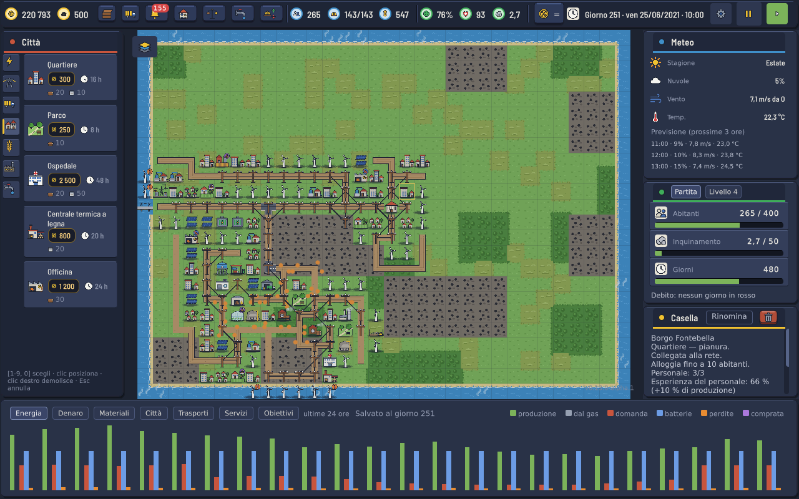
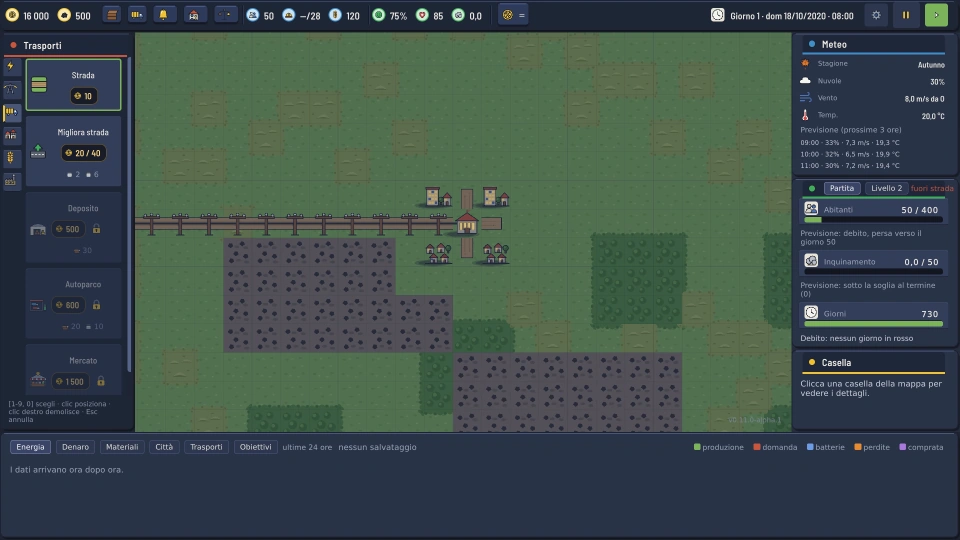

  

🇮🇹 Italiano · 🇬🇧 [English](README.md) · 🇩🇪 [Deutsch](README.de.md) · 🇫🇷 [Français](README.fr.md) · 🇪🇸 [Español](README.es.md)

# ⚡ Voltvale: Energy Grid Tycoon

**Sei il gestore elettrico di una cittadina che cresce.** Ogni ora la città chiede energia: poca di notte, tanta
la sera. Costruisci centrali, impianti solari, parchi eolici e batterie, collega tutto con le linee elettriche e
le strade, trova chi ci lavori, un turno dopo l'altro, dai da mangiare a tutti, scalda le case d'inverno, porta
l'acqua nelle case e togli i rifiuti dalle strade, porta merci e materiali coi camion senza intasare il traffico, e fai crescere il villaggio fino a **400 abitanti in due anni di gioco**, senza blackout continui, senza
debiti e senza soffocarlo di inquinamento.

Un gioco originale di **Marco Scarlino**. Gratuito. Sito ufficiale: **[voltvale.it](https://voltvale.it/it/)**.

## Trailer

**[▶ Guarda il trailer (1 minuto)](https://scrnetto.github.io/voltvale/trailer/voltvale-trailer-it.mp4)** ·
anche in [inglese](https://scrnetto.github.io/voltvale/trailer/voltvale-trailer-en.mp4),
[tedesco](https://scrnetto.github.io/voltvale/trailer/voltvale-trailer-de.mp4),
[francese](https://scrnetto.github.io/voltvale/trailer/voltvale-trailer-fr.mp4) e
[spagnolo](https://scrnetto.github.io/voltvale/trailer/voltvale-trailer-es.mp4)

> **Stato: in sviluppo (alpha).** Il gioco si gioca dall'inizio alla fine, ma mancano ancora molte cose e qualcosa
> può non funzionare. Ogni segnalazione aiuta: vedi [Segnalare un problema o un'idea](#segnalare-un-problema-o-unidea).

## Gioca subito nel browser

**[▶ Gioca a Voltvale nel browser](https://scrnetto.github.io/voltvale/)**: niente da
installare. Serve un browser recente (Chrome, Firefox, Edge, Safari) su un computer con mouse e tastiera, oppure su
un tablet: **tocco = clic, tocco lungo = clic destro**. Clicca sul gioco prima di usare la tastiera. I salvataggi
restano nel browser che usi.
Su un telefono tenuto **in orizzontale** il gioco passa a una disposizione fatta apposta (ancora in prova: vedi
[Problemi noti](#problemi-noti)).

**C'è anche su itch.io: [marcoscarlino.itch.io/voltvale](https://marcoscarlino.itch.io/voltvale)**, dove puoi
giocare nel browser, scaricare il gioco per ogni sistema e lasciare un commento. I salvataggi fatti nel browser su
itch.io sono separati da quelli fatti qui.

## Scaricare il gioco

Tutte le versioni sono nella pagina **[Releases](../../releases)**. Scarica il file del tuo sistema dall'ultima
versione:

| Sistema | File | Come avviarlo |
|---|---|---|
| **Windows** 10/11 (64 bit) | `Voltvale-<versione>-windows.zip` | Estrai lo zip e apri `Voltvale.exe` |
| **macOS** 12 o successivo | `Voltvale-<versione>-macos.zip` | Estrai lo zip e apri `Voltvale.app` |
| **Linux** (64 bit) | `Voltvale-<versione>-linux.zip` | Estrai lo zip e avvia `Voltvale` |
| **Android** 8 o successivo (tablet o telefono) | `Voltvale-<versione>-android.apk` | Apri il file sul dispositivo e installalo (vedi sotto) |

### Al primo avvio

Il gioco non è firmato con un certificato a pagamento, quindi il sistema può avvisarti che viene da uno
sviluppatore sconosciuto. È normale per i giochi indipendenti.

- **Windows**: se compare «Windows ha protetto il PC», clicca **Ulteriori informazioni**, poi **Esegui comunque**.
- **macOS**: se compare «impossibile aprire perché lo sviluppatore non è verificato», fai **clic destro
  sull'app → Apri**, poi conferma con **Apri**. Basta la prima volta. Se il Mac dice che l'app «è danneggiata»,
  apri il Terminale nella cartella dello zip e scrivi `xattr -cr Voltvale.app`.
- **Linux**: se non parte, rendi il file eseguibile con `chmod +x Voltvale`.
- **Android**: il gioco non è sul Play Store. Scarica l'`.apk` sul dispositivo e aprilo; la prima volta Android
  chiede di permettere le installazioni dal browser o dal gestore dei file («Installa app sconosciute»). Play
  Protect può avvisare che l'app è sconosciuta: scegli di installarla comunque. Per aggiornare, installa il nuovo
  `.apk` sopra il vecchio. Sullo schermo touch: **tocco = clic, tocco lungo = clic destro**, due dita per spostare
  la mappa e per ingrandirla.

**Controllare il download (facoltativo).** Ogni versione ha un file `SHA256SUMS.txt` con l'impronta di ogni zip.
Su Linux si controlla con `sha256sum -c --ignore-missing SHA256SUMS.txt`, su macOS con `shasum -a 256 -c SHA256SUMS.txt`.

### Requisiti

- Uno schermo da almeno 1280×800, oppure un telefono tenuto in orizzontale.
- Mouse e tastiera, oppure uno schermo touch (tablet o telefono, versione web o Android).
- Circa 200 MB di spazio.
- Una scheda video qualsiasi degli ultimi 10 anni: anche quelle integrate vanno bene.

## Come si gioca

Il gioco si apre con il **menu iniziale**: **Nuova partita**, dove scegli il nome della città e la difficoltà (vedi
[Nuova partita](#nuova-partita)), oppure **Continua** per riprendere l'ultimo salvataggio. La partita comincia **domenica 18 ottobre 2020** alle 8 e parte **in pausa**: premi **Spazio** per far
scorrere il tempo. A velocità 1× un'ora di gioco dura un secondo, e puoi accelerare a 2× e 4×. Le stagioni seguono
il calendario: si parte in autunno, e d'inverno le giornate sono più corte e il cielo più coperto. La barra in alto
mostra il giorno della partita, il giorno della settimana, la data e l'ora, per esempio
«Giorno 1 · dom 18/10/2020 · 08:00».

- **Obiettivo**: arrivare a **400 abitanti** con l'inquinamento **sotto la soglia** entro **2 anni**. Dopo la
  vittoria puoi **continuare a giocare**, senza più limite di tempo.
- **Sconfitta**: se resti in rosso con i soldi per **30 giorni di fila**, se la città resta sotto i **5 abitanti per
  14 giorni di fila**, oppure se finiscono i 2 anni prima della vittoria.
- **Il municipio cresce**: da **villaggio** a **paese**, **cittadina** e **città**, compiendo piccoli obiettivi. A ogni
  livello si sbloccano costruzioni nuove: vedi [Livelli del municipio e obiettivi](#livelli-del-municipio-e-obiettivi).
- **Si costruisce con le squadre**: un edificio nuovo è prima un **cantiere**, e funziona quando una squadra ha finito
  il lavoro. Vedi [Cantieri e squadre](#cantieri-e-squadre).
- **La rete**: ogni costruzione deve essere collegata al **municipio**. Le **linee elettriche** partono dal
  municipio e lo allungano, anche in diagonale. Una costruzione è collegata se tocca il municipio, una linea
  oppure un'altra costruzione già collegata: un gruppo di costruzioni attaccate è collegato se una di loro tocca
  la rete.
- **Le strade**: oltre alla corrente, ogni costruzione deve toccare con un lato una **strada collegata al
  municipio** (le linee elettriche no). Vedi [Strade e traffico](#strade-e-traffico).
- **Domanda ed energia**: la città consuma poco di notte e molto la sera, verso le 19. Se l'energia non basta, e
  nemmeno quella comprata da fuori, c'è il **blackout**: gli abitanti si arrabbiano e qualcuno se ne va.
- **Le fonti**:
  - il **sole** produce solo di giorno, poco d'inverno e col cielo coperto;
  - il **vento** cambia forza e direzione di ora in ora (il pannello Meteo dice da dove soffia); un parco eolico
    **sottovento** a un altro, a poche caselle, rende meno (la «scia» delle pale, fino al 40 % in meno);
  - il **carbone** produce giorno e notte, ma inquina, consuma il carbone estratto dalle **miniere** e cambia
    potenza piano, al più di un quarto della capacità all'ora;
  - il **gas** si accende solo quando l'energia manca, per i picchi della sera, ma il gas arriva dalla terraferma e
    costa denaro a ogni ora.
- **Batterie**: accumulano l'energia in più e la restituiscono quando serve, per esempio la sera.
- **Corrente da fuori**: l'energia in più si **vende** e quella che manca si **compra**, al doppio del prezzo, dalla
  **linea di confine** accanto al ponte; più ne vendi in un'ora, meno vale. Vedi
  [Collegamenti con la terraferma](#collegamenti-con-la-terraferma).
- **Inquinamento**: le centrali a carbone inquinano e l'aria si pulisce piano. Una centrale si regge, troppe no.
  Inquinano anche, meno, le centrali a gas e termiche, il cementificio quando lavora e le discariche. Fa ammalare gli
  abitanti, e sopra la soglia non si vince.
- **Crescita**: la città cresce se gli abitanti sono abbastanza **felici**, c'è posto nei **quartieri** e c'è abbastanza
  **cibo** in magazzino.
- **Riscaldamento**: sotto i 15 °C le case chiedono **calore**, dalle centrali termiche a legna o dalle caldaie a gas
  dei quartieri. Le case al freddo rendono gli abitanti infelici e malati. Vedi
  [Calore, gas e carburante](#calore-gas-e-carburante).
- **Acqua**: le case ricevono l'acqua solo dalle fonti che le hanno nel loro **raggio**; senz'acqua gli abitanti sono
  infelici e si ammalano. Vedi [Acqua](#acqua).
- **Rifiuti**: vanno raccolti e portati in discarica o fuori città; i rifiuti per strada rendono la città meno felice.
  Vedi [Rifiuti](#rifiuti).

### Nuova partita

**Nuova partita** (dal menu iniziale o dal menu di pausa) apre una schermata dove scegli:

- il **nome della città**: il gioco ne propone uno, il pulsante con il dado ne propone un altro, oppure lo scrivi tu.
  Il municipio porta il nome della città;
- la **difficoltà**: **facile** (denaro iniziale ×1,5, manutenzione ×0,8), **normale** o **difficile** (denaro
  iniziale ×0,7, manutenzione ×1,2).

Le voci «Disastri» e «Dimensione della mappa» ci sono già, ma per ora i disastri sono spenti e la mappa è una sola.

### Livelli del municipio e obiettivi

Il municipio cresce con la città: **I villaggio**, **II paese**, **III cittadina**, **IV città**.

- Ogni livello ha **4 obiettivi**, e ognuno, quando lo compi, dà un **premio in denaro**:
  - per diventare **paese**: 100 abitanti, 5 quartieri collegati, 3 giorni senza blackout, felicità almeno 60 %;
  - per diventare **cittadina**: 200 abitanti, una segheria che produce, un deposito, 20 000 in cassa;
  - per diventare **città**: 400 abitanti, un ospedale, inquinamento sotto 30, 7 giorni senza blackout.
- Quando gli obiettivi del livello sono tutti compiuti, nella Casella del municipio si accende **Potenzia** (l'icona
  con la freccia, in alto). Costa denaro e materiali (paese 3 000 e 40 legname, cittadina 8 000, 80 legname e 60
  pietra, città 15 000, 100 legname, 100 pietra e 80 cemento) e i lavori durano da uno a tre giorni. Il municipio non
  sale mai da solo.
- Le costruzioni si **sbloccano** così:

| Livello | Costruzioni |
|---|---|
| **I villaggio** | linee, sterrate, quartieri, impianti solari, parchi eolici, centrali e miniere di carbone, batterie, fattorie, parchi, pozzi, centri di raccolta, discariche |
| **II paese** | strade asfaltate, depositi, autoparchi, segherie, cave, serre, magazzini frigoriferi, pescherecci, centrali a gas, centrali termiche a legna, Mercato, Officina, torri dell'acqua, prese dal lago; fonti d'acqua di livello II |
| **III cittadina** | viali, cementifici, trasformatori, ospedali, pompaggio, desalinizzatori; fonti d'acqua di livello III |
| **IV città** | per ora niente di nuovo, salvo il pozzo del municipio che arriva più lontano: servirà alle costruzioni dei prossimi aggiornamenti |

- Nella lista le costruzioni ancora bloccate sono spente, con il **lucchetto**; passando il mouse si legge il livello
  che serve. Il **Mercato** si costruisce una volta sola per città: dopo il primo diventa grigio.
- Il pannello **Obiettivi** ha due schede: **Partita** (l'obiettivo finale e la previsione) e **Livello** (gli
  obiettivi del livello, con quanti ne hai compiuti). Alcuni obiettivi, come la felicità, si contano a mezzanotte: il
  pannello scrive «raggiunto: conta a mezzanotte».
- Per il traffico il municipio conta come una strada asfaltata, e come un viale da cittadina.

### Cantieri e squadre

- Quando posi un edificio paghi subito, e al suo posto si apre un **cantiere**. Una **squadra** parte dal municipio,
  arriva e lavora per le ore del cantiere; l'edificio funziona quando ha finito.
- Ogni costruzione ha il suo **tempo di costruzione**, scritto nella lista e nel riquadro accanto al costo: per
  esempio 8 ore per un parco, 12 per un impianto solare, 24 per un parco eolico, 48 per una centrale a carbone o un
  ospedale. Linee e strade restano immediate.
- Le squadre lavorano **dalle 8 alle 17**, tutti i giorni. Il municipio ne ha **2**: se i cantieri sono di più, si
  mettono **in fila** e aspettano una squadra libera.
- L'**Officina** (scheda Città, da paese) aggiunge **2 squadre**, che partono da lì: conviene quando i cantieri restano
  a lungo in fila, o lontano dal municipio. Ha bisogno di personale, di corrente e di una strada.
- Le squadre fanno **esperienza** nei lavori edili, elettrici e meccanici: più lavorano, più sono veloci, fino al 50 %
  in più.
- Un clic su un cantiere mostra nella Casella se è in fila (e in che posizione), se la squadra è in arrivo o al
  lavoro e quante ore mancano. Le Caselle del municipio e dell'Officina mostrano le squadre, che cosa fanno e la loro
  esperienza.
- Un cantiere si demolisce come una costruzione, con il rimborso di metà della spesa.

### Collegamenti con la terraferma

La mappa è un'**isola**, unita alla terraferma da un **ponte a ovest**, all'altezza del municipio.

- Accanto al ponte ci sono la **linea di confine** e la **strada statale**, già collegate al municipio da una fila di
  linee e da una sterrata. Ponte, linea di confine e strada statale non si demoliscono; le linee e la sterrata sì, ma
  senza collegamento la città non scambia più niente.
- **Corrente**: l'energia in più si **vende**; quella che manca si **compra**, al doppio del prezzo, finché ci sono
  soldi. Così la partita non comincia al buio mentre si aspettano i primi cantieri, ma comprare tutto a lungo svuota la
  cassa.
- Si scambia solo fino alla **portata** della linea, che cresce con il livello del municipio:

| Municipio | Vendita fino a | Acquisto fino a |
|---|---|---|
| I villaggio | 40 MW | 20 MW |
| II paese | 60 MW | 30 MW |
| III cittadina | 90 MW | 45 MW |
| IV città | 120 MW | 60 MW |

  Nelle ore di punta di una città grande la corrente comprata non basta: servono centrali e batterie proprie.
- Nella Casella della linea di confine ci sono i due interruttori **Vendi** e **Compra**, le portate, il prezzo
  d'acquisto e quanto si è comprato e venduto nell'ultima ora. Con «Compra: no» la città va in blackout quando la
  produzione non basta.
- Un'**icona dello scambio** sopra la linea di confine dice quando nell'ultima ora si è comprato o venduto; il grafico
  **Energia** mostra la corrente comprata.
- **Merci da fuori**: cibo importato, rame e scambi del Mercato passano dalla **strada statale**, e arrivano solo se è
  collegata alle strade della città. Dalla stessa strada escono i rifiuti portati fuori città.

### Lavoro e personale

Le costruzioni hanno bisogno di qualcuno che le faccia funzionare.

- Lavora circa il **56 %** degli abitanti. La barra in alto mostra quante persone hanno un lavoro sulla forza
  lavoro disponibile.
- **Centrali a carbone**, **miniere di carbone**, **industrie**, costruzioni del **cibo**, **ospedali**, **parchi**,
  **magazzini frigoriferi**, **depositi**, **officine**, **pompaggio**, **centrali a gas**, **centrali termiche a legna**,
  **desalinizzatori** e **centri di raccolta** hanno bisogno di personale. **Impianti solari**, **parchi eolici**,
  **batterie**, linee, trasformatori, **pozzi**, **torri dell'acqua**, **prese dal lago** e **discariche** vanno da soli.
- Il pannello **Casella** mostra quanti posti sono coperti, per esempio **Personale: 4/4**, e quante persone ci
  vogliono, turni compresi.
- Con poco personale una costruzione produce meno; **senza nessuno si ferma** e mostra il segnale **«senza
  personale»**.
- All'inizio i lavoratori vanno **prima all'energia e ai trasporti**, poi **al cibo**, poi **a ospedali, calore e
  acqua**, poi **alle industrie e ai rifiuti**, poi **alle miniere**, poi **a quartieri e parchi**. L'ordine lo cambi
  tu nel pannello **Lavoro**: vedi [Priorità del lavoro](#priorità-del-lavoro). I quartieri funzionano anche quando
  ai loro servizi manca personale.
- La **disoccupazione** costa: chi non lavora non paga l'imposta sul reddito e riceve un sussidio dal comune; se è
  alta, gli abitanti sono meno felici.

### Orari e turni

Ogni costruzione con personale ha il suo orario, che la Casella mostra:

| Orario | Costruzioni | Persone per posto |
|---|---|---|
| **Sempre aperta, 3 turni (6, 14, 22)** | centrali a carbone e a gas, centrali termiche a legna, miniere di carbone, ospedali, magazzini frigoriferi, autoparchi, pompaggio, desalinizzatori | circa 4: un posto coperto giorno e notte vuole tre turni più i riposi |
| **Aperta 8–17, dal lunedì al venerdì** | segherie, cave, cementifici, depositi | 1 |
| **Aperta 8–17, tutti i giorni** | fattorie, pescherecci, serre, parchi, officine, centri di raccolta, i servizi dei quartieri | circa 1,4, per i giorni di riposo |

- Una centrale a carbone con tutti i posti coperti impiega circa **17 persone**: tienine conto quando costruisci i
  quartieri.
- **Fuori orario la costruzione è chiusa**: non produce e non consuma energia né materiali. La Casella dice quando
  riapre, per esempio «Chiusa: riapre lunedì alle 08:00». I lavoratori tengono il posto anche mentre è chiusa.
- Le industrie sono chiuse **il fine settimana**: tieni da parte legname e cemento per il sabato e la domenica.
- Le costruzioni del cibo lavorano tutti i giorni, ma solo di giorno: fattorie, pescherecci e serre producono dalle
  8 alle 17.

### Cibo

Gli abitanti mangiano ogni ora. La scorta di cibo è nella barra in alto, accanto alla spiga, e diventa rossa quando
sta per finire.

- **Fattoria** (pianura): produce secondo la stagione, molto d'estate e **niente d'inverno**.
- **Peschereccio** (costa): pesca tutto l'anno, ma si ferma quando il vento è troppo forte.
- **Serra** (pianura o collina): produce tutto l'anno, però **consuma molta energia**.
- **Magazzino frigorifero** (pianura): fa crescere la scorta che la città può tenere.
- **Il cibo passa dalla rete**: le costruzioni del cibo consumano energia. Durante un **blackout** non producono e
  i frigoriferi perdono una parte del cibo in più.
- **Se la scorta finisce**, il cibo arriva da fuori in automatico dalla strada statale, ma costa caro. Con il cibo importato la città
  non muore di fame, però **non cresce**: per crescere serve almeno un giorno di scorta propria.
- **Se finiscono anche i soldi** arriva la fame, e gli abitanti se ne vanno.
- Il pannello **Casella** mostra quanto ha prodotto ogni costruzione nell'ultima ora (per esempio **Cibo: 5,4/h**), quanto spazio
  aggiunge un frigorifero e quanta energia consuma.

### Felicità, salute e tasse

- **Felicità** (lo smile nella barra in alto): si muove piano verso un valore che è la somma di alcuni fattori, cioè
  blackout delle ultime 24 ore, cibo, fame, freddo nelle case, acqua che manca, rifiuti per strada, discariche vicine,
  disoccupazione, inquinamento, salute, parchi, tasse e conti di casa. Passando il
  mouse sul numero vedi verso quale valore sta andando e quanto pesa ogni fattore, per esempio «Blackout −5,0» o
  «Parchi +3,0». Sotto 60 la città non cresce, e sotto 35 la gente comincia ad andarsene.
- **Salute** (il cuore): cala con l'inquinamento, con la fame, con il freddo nelle case, con l'acqua che manca e con i
  rifiuti per strada. I **malati restano a casa**, quindi ci sono meno
  lavoratori, e una città poco sana è anche meno felice.
- **Ospedale** (pianura): cura fino a 250 abitanti, ha bisogno di personale e consuma energia. Durante un
  blackout non cura. Indispensabile se punti sul carbone.
- **Parco** (pianura o collina): rende la gente più felice. Conta di più in una città piccola: ogni parco vale +3
  ogni 100 abitanti, fino a +10.
- **Tasse**: sono l'imposta sul reddito di chi lavora, su tre livelli, basse, normali e alte, con il pulsante con la
  moneta nella barra in alto o il tasto **T**. Tasse alte portano più soldi ma meno felicità; tasse basse fanno il
  contrario.

### Stipendi, famiglie e bollette

- Il comune paga uno **stipendio** per ogni posto di lavoro coperto, un po' di più per i turni di notte.
- Il personale fa **esperienza**: chi resta nello stesso lavoro rende fino al **15 %** in più, ma guadagna anche di
  più. Quando il personale cambia, l'esperienza cala: tenere stabili i lavoratori conviene. La Casella mostra
  esperienza e stipendi di ogni costruzione.
- Le famiglie pagano al comune l'**imposta sul reddito**, la **bolletta della luce** dei quartieri, quelle del
  **riscaldamento** e dell'**acqua**, la **tassa sui rifiuti**, il **cibo** e l'**affitto**. Chi non ha lavoro riceve un **sussidio**. Le famiglie hanno anche altri redditi, come pensioni e
  lavoro fuori città.
- Pannello **Famiglie** (tasto **H** o il pulsante in alto): entrate e spese delle famiglie nelle ultime 24 ore,
  quanto resta a ogni abitante al giorno e stipendio medio. Da qui si cambia la **tariffa dell'energia**: bassa,
  normale o alta. Una tariffa alta porta più soldi al comune, ma lascia meno alle famiglie.
- Quanto resta alle famiglie pesa sulla felicità («Conti di casa» nel riquadro della felicità).

### Calore, gas e carburante

- **Calore**: quando la temperatura scende sotto i **15 °C** le case chiedono calore, tanto più quanto fa freddo e
  quanti più abitanti ci sono. La partita comincia in autunno, quindi serve già dalle prime notti; d'estate no.
- Il calore lo danno prima le **centrali termiche a legna**, poi le **caldaie a gas** dei quartieri. Le caldaie non si
  costruiscono: ci sono già e comprano il gas dalla terraferma.
- **Case al freddo**: il calore che manca toglie fino a 20 punti di **felicità** («Freddo nelle case» nel tooltip
  della felicità) e peggiora la **salute**. I quartieri al freddo mostrano un fiocco di neve, e l'avviso «Case al
  freddo» compare sopra la mappa e nel registro degli eventi.
- Le famiglie pagano al comune la **bolletta del riscaldamento**, con la tariffa dell'energia che hai scelto. Nel
  pannello **Famiglie** l'interruttore **Riscaldamento a gas** spegne le caldaie a gas: si risparmia il gas, ma le
  case restano al freddo.
- **Centrale termica a legna** (scheda Città, da paese): a pieno dà 15 unità di calore all'ora e brucia 3,75 di
  legname, che i camion portano nel suo silo. Costa 800 e 20 di cemento, si costruisce in 20 ore, è sempre aperta e ha
  bisogno di personale e di corrente. Senza legname si ferma. Il legname che brucia è legname che non userai per
  costruire né venderai.
- **Centrale a gas** (scheda Energia, da paese): 15 MW, costa 900 e 30 di cemento e si costruisce in 24 ore. Si accende
  **solo quando l'energia manca**: dopo le batterie e prima di comprare corrente. Non produce per vendere. A pieno
  brucia 42 di gas all'ora, e inquina meno del carbone.
- **Gas e carburante** si comprano ora per ora, solo quanto serve, dalla **strada statale**, finché c'è denaro: il gas
  costa 1,20 all'unità, il carburante 6, meno con un Mercato in città. Il pannello Mercato mostra i prezzi di oggi.
- **Crisi del gas**: una volta per inverno, fra metà novembre e fine gennaio (mai nei primi due mesi di partita), per
  due o tre settimane il gas costa **2,7 volte** tanto e il carburante 1,5 volte. L'avviso «Tensioni sul gas» arriva
  tre giorni prima. Durante la crisi metà del rincaro del riscaldamento lo pagano le famiglie e metà il comune, e
  comprare la corrente spesso costa meno che accendere la centrale a gas.
- **Il carbone è lento**: una centrale a carbone cambia potenza al più di un quarto della sua capacità all'ora, quindi
  una nuova ci mette 4 ore ad arrivare al massimo. Quando la rete non sa dove mettere l'energia (batterie piene,
  vendita al limite) scende e brucia meno carbone, ma poi non risale in fretta per il picco della sera. La Casella dice
  se è in salita o in discesa.

### Acqua

- **Chi ha bisogno d'acqua**: le **case**, cioè i quartieri e il municipio, ogni ora, di più al mattino e alla sera e
  di più col caldo, sopra i 18 °C. Industrie e servizi ne fanno a meno.
- **Il raggio**: una casa riceve l'acqua solo se sta nel **raggio** di una fonte, un quadrato attorno alla fonte: 3
  caselle in ogni direzione al livello I (un quadrato di 7×7). Le tubature non si posano: il raggio è la rete. Una casa fuori da
  ogni raggio resta senz'acqua anche se la città ne ha in abbondanza.
- Il **municipio** ha già un **pozzo** (1,6 d'acqua all'ora) e un **serbatoio** da 8. Il suo raggio cresce con il
  livello del municipio: 3, 4, 5 e 6 caselle. Basta alle prime case.
- Le fonti (scheda **Servizi** della lista):

| Costruzione | Acqua | Dove | Da | Costo |
|---|---|---|---|---|
| **Pozzo** | 3 all'ora, d'estate un po' meno | pianura, collina | villaggio | 350 e 5 di cemento, 8 ore |
| **Torre dell'acqua** | tiene fino a 60, raggio 4 caselle | pianura, collina | paese | 500 e 20 di cemento, 12 ore |
| **Presa dal lago** | 8 all'ora, con poca energia | accanto a un lago | paese | 900 e 15 di cemento, 16 ore |
| **Desalinizzatore** | 6 all'ora in ogni stagione, molta energia, 1 posto di lavoro | costa | cittadina | 2 200, 40 di cemento e 5 di rame, 40 ore |

- La **torre** dà la sua acqua alle case entro 4 caselle. La riempiono le pompe che la hanno nel loro raggio, mai
  un'altra torre: messa al bordo del raggio di un pozzo, porta l'acqua un passo più in là. La Casella dice quante pompe
  la riempiono.
- **Potenzia** (icona nella Casella di pozzi, prese dal lago e desalinizzatori): il livello **II** (da paese) porta il
  raggio a 5 caselle e l'acqua a una volta e mezza; il livello **III** (da cittadina) a 7 caselle e al doppio. Costa il
  40 % o l'80 % del prezzo della costruzione, più cemento e rame; la fonte non si ferma. Le torri non si potenziano.
- Le **pompe consumano energia**: un desalinizzatore molta, una presa dal lago poca. In blackout danno meno acqua.
- **Modalità delle pompe** (pannello **Acquedotto e rifiuti**, tasto **U**):
  - **«Seguono il consumo»** (di partenza): le pompe danno l'acqua quando serve, anche alle 19, nel picco della sera;
  - **«Con l'energia in più»**: le torri danno l'acqua per prime, tenendo un quarto di riserva, e le pompe le
    riempiono con l'energia che avanza, dopo le batterie e prima di venderla. La sera le pompe pesano meno sulla rete.
    Serve almeno una torre.
- **Senz'acqua**: l'acqua che manca toglie fino a **15 punti di felicità** («Senz'acqua» nel tooltip) e peggiora la
  **salute**. I quartieri che ricevono meno di metà dell'acqua che serve mostrano una goccia barrata.
- Le famiglie pagano al comune la **bolletta dell'acqua** che ricevono, con la tariffa scelta nel pannello Famiglie.

### Rifiuti

- La città produce **rifiuti** ogni ora: più abitanti, più rifiuti.
- Li raccolgono le **squadre del municipio**, dalle 8 alle 17, e i **centri di raccolta** (da villaggio, 500 e 20 di
  legname): 3 tonnellate all'ora, 4 posti di lavoro, aperti dalle 8 alle 17 tutti i giorni. La notte i rifiuti si
  accumulano: è normale.
- I rifiuti raccolti vanno nelle **discariche** (da villaggio, costano 400, tengono 5 000 tonnellate), nell'ordine in
  cui le hai costruite. Quando sono tutte piene si portano **fuori città** dalla strada statale, a **3 la tonnellata**;
  se la strada statale è scollegata o il denaro è finito, restano per strada.
- Una discarica:
  - **puzza**: i quartieri entro 2 caselle perdono un po' di felicità («Discarica vicina»);
  - inquina la **falda**: un pozzo entro 2 caselle, anche da una discarica vuota, si ferma («falda inquinata»). Prese
    dal lago, desalinizzatori e il pozzo del municipio non ne risentono;
  - inquina un po' l'**aria**, tanto più quanto è piena;
  - **non si demolisce** finché contiene rifiuti.
- **Rifiuti per strada**: quando restano per strada più di un giorno di rifiuti, la città perde fino a **10 punti di
  felicità** e un po' di salute.
- Le famiglie pagano la **tassa sui rifiuti**, fissa per abitante.
- Il pannello **Acquedotto e rifiuti** (tasto **U** o il pulsante con il rubinetto in alto) mostra acqua richiesta e
  fornita, serbatoi e pompe, case fuori dal raggio, e i rifiuti prodotti, raccolti, per strada, nelle discariche e
  portati fuori città.

### Materiali e industrie

Quasi tutte le costruzioni costano, oltre ai soldi, dei **materiali**: **legname** e **cemento**. La lista a
sinistra li mostra sotto il prezzo, con piccole icone; passando il mouse sul pulsante si leggono per esteso.

- **Segheria** (solo nel **bosco**, le caselle verde scuro): 7,5 legname all'ora.
- **Cava** (colline): 7,5 pietra all'ora.
- **Cementificio** (pianura): trasforma 7,5 pietra in 7,5 cemento all'ora, consuma molta corrente e **inquina** in
  proporzione a quanto produce: a pieno ritmo quanto un quarto di una centrale a carbone. Senza pietra si ferma, e
  smette anche di consumare corrente e di inquinare.
- Le industrie lavorano **dalle 8 alle 17, dal lunedì al venerdì** (vedi [Orari e turni](#orari-e-turni)).
- Le industrie hanno bisogno di **personale** e di **corrente**. I lavoratori ci vanno dopo energia, cibo e
  ospedali, e prima delle miniere di carbone.
- **Se i materiali non bastano** quando costruisci, la parte che manca si compra subito da fuori (legname 10,
  cemento 22 l'unità). Si può giocare anche senza industrie, ma costa di più.
- Si parte con 200 di legname e 200 di cemento.
- Il pulsante **Scorte**, accanto al carbone nella barra in alto, apre un piccolo pannello con carbone, legname,
  pietra, cemento e cibo, e quanto entra ed esce ogni ora (compreso il legname bruciato dalle centrali termiche). Si chiude con un clic fuori o con **Esc**.
- Il pannello **Casella** mostra quanto produce e consuma un'industria, e «fermo: manca pietra» quando è finita.

### Strade e traffico

- Ogni costruzione, linee escluse, deve toccare con un lato una **strada collegata al municipio**. Senza strada è
  ferma e mostra il segnale «senza strada». Si parte con quattro sterrate attorno al municipio e una verso la strada
  statale.
- Strumento **Strada** (tasto **R**, o il primo pulsante della lista): clic o trascina per posare le **sterrate**.
  Una strada può passare sotto una linea elettrica, ma non sotto altre costruzioni.
- Strumento **Migliora strada** (tasto **M**): **sterrata → strada asfaltata** (da paese) **→ viale** (da
  cittadina). Ogni livello porta più
  traffico ed è più veloce, ma costa cemento. Dopo il miglioramento la casella resta qualche ora in **cantiere**, con
  meno spazio per il traffico.
- **Pendolari**: i lavoratori vanno dai quartieri al lavoro quando comincia il loro orario e tornano a casa quando
  finisce: verso le 8 e le 17 per la maggior parte delle costruzioni, alle 6, alle 14 e alle 22 per i turni di
  quelle sempre aperte. Il fine settimana le industrie sono chiuse e le strade più tranquille. Se le strade sono
  piene si va piano: chi arriva in ritardo rende meno, e il ritardo del giorno prima toglie **felicità**
  («Traffico dei pendolari» nel riquadro della felicità).
- I **viali** reggono molto traffico ma sono **rumorosi**: tolgono un po' di felicità ai quartieri accanto.
- **Vista del traffico** (tasto **G**, o dal pulsante **Viste**): colora le strade secondo quanto sono cariche. Vedi
  [Viste della mappa](#viste-della-mappa).
- Pannello **Trasporti** (tasto **J** o il pulsante con il camion in alto): persone e merci in viaggio, tempo medio,
  camion usati, le **strade più cariche** (un clic le mostra nella Casella) e l'andamento delle ultime 24 ore.
- Per demolire una strada: clic destro, come per le costruzioni (rimborso di metà della spesa).

### Merci e camion

- Chi produce (miniere, segheria, cava, cementificio, fattorie, pescherecci, serre) mette la merce nel suo
  **piazzale**. I **camion** la portano al municipio o al **deposito** più vicino, e da lì ai **silo** di chi la
  consuma: le centrali a carbone, il cementificio e le centrali termiche a legna. Il magazzino frigorifero fa da
  deposito per il cibo.
- Il municipio ha **2 camion**; ogni **autoparco** ne aggiunge **3** (servono personale e corrente). Strade migliori
  e meno traffico fanno viaggiare di più gli stessi camion.
- Se i camion non bastano arriva l'avviso «**Camion insufficienti**»: i piazzali si riempiono e chi produce si ferma
  («fermo: piazzale pieno»). Serve un autoparco, o un deposito più vicino.
- Un piazzale tiene una quantità limitata: una segheria, una cava o un cementificio a pieno ritmo possono
  riempirlo prima di sera se i camion non stanno al passo.
- Il **cibo si rovina** un po' a ogni viaggio: più la fattoria è lontana, più se ne perde.
- I **camion consumano carburante**, comprato ora per ora dalla strada statale: più strada fanno, più costa. Senza
  denaro o con la strada statale scollegata tutta la flotta si ferma («Camion fermi: niente carburante»).
- La Casella mostra piazzale, silo e distanza dal deposito; le **Scorte** mostrano quanto aspetta nei piazzali.

### Mercato

- Il **Mercato** si costruisce dalla scheda **Trasporti** della lista, da paese; ce n'è uno per città. Ha bisogno di
  una strada e di personale, ed è aperto dalle 8 alle 17 nei giorni feriali. Gli scambi passano dalla **strada
  statale**: se non è collegata, il Mercato non compra né vende.
- Con il Mercato i materiali e il cibo si comprano **senza il sovrapprezzo** dell'importazione, e si possono comprare
  anche **carbone e pietra**. Quello che avanza si **vende** al 70 % del prezzo d'acquisto.
- Pannello **Mercato** (tasto **K** o il pulsante con la bilancia in alto): per ogni materiale la scorta e i prezzi; le
  soglie **«Vendi sopra»** e **«Compra sotto»** fanno scambiare il Mercato da solo, ora per ora; i pulsanti
  **«Compra 10»** e **«Vendi 10»** valgono subito, anche fuori orario.
- Vendite e acquisti compaiono nel registro degli eventi e nella scheda **Denaro** del grafico.
- Il riquadro **Combustibili importati** mostra i prezzi di oggi di gas e carburante, anche prima di costruire il
  Mercato. Con un Mercato in città costano meno, senza sovrapprezzo. Non si tengono in magazzino e non si vendono.

### Perdite di linea

- L'energia di una centrale si perde lungo le linee fino al **nodo** più vicino: il **municipio** o un
  **trasformatore** (si costruisce dalla lista). Più la centrale è lontana, più perde; la Casella mostra quanto.
- Strumento **Migliora linea** (tasto **L**): le linee passano dal livello **I** al **II** e al **III** e perdono
  meno, ma costano **rame**, che si compra da fuori e arriva dalla strada statale.
- Il grafico **Energia** in basso ha una barra per le perdite.

### Miniere e laghi

- Ogni giacimento ha la sua **riserva** di carbone, diversa da casella a casella: la Casella della miniera mostra
  quanta ne resta e per quanti giorni. Quando sta per finire la miniera rende meno; arrivano gli avvisi «miniera
  quasi esaurita» e «miniera esaurita».
- Tre giorni dopo l'esaurimento la miniera sparisce e al suo posto nasce un **lago**. Il lago:
  - rinfresca le **centrali a carbone** vicine, che producono un po' di più;
  - fa piacere ai **quartieri** accanto, come un parco;
  - ospita i **pescherecci**;
  - permette il **pompaggio**, una batteria grande che si costruisce solo accanto a un lago.

### Nomi

- Vie, quartieri, ospedali e parchi hanno un **nome**, e la Casella lo mostra in cima: per esempio «Via Volta» o
  «Borgo Valfiora». Una via tiene lo stesso nome lungo tutto il suo tratto dritto.
- Il pulsante **Rinomina** nella Casella cambia il nome; lasciandolo vuoto torna quello automatico.

### Registro degli eventi

- La **campanella** in alto conta gli eventi nuovi; diventa rossa quando uno è grave.
- Il pannello **Eventi** (tasto **E** o la campanella) mostra in cima i **problemi in corso**: debito, costruzioni
  scollegate, senza personale o senza strada, piazzali pieni, miniere quasi esaurite, cibo importato, case senz'acqua o
  fuori dal raggio, pozzi con la falda inquinata, discariche piene, rifiuti per strada. Sotto c'è lo
  **storico** di quello che è successo, con i filtri per tipo.
- Un clic su una riga centra la mappa sul posto e apre la Casella.

### Previsione degli obiettivi

- Il pannello **Obiettivi** dice come andrà la partita **alle condizioni attuali, senza nuove costruzioni**: verso
  quale giorno arriverai a 400 abitanti, se l'inquinamento resterà sotto la soglia, oppure se finirai in debito.
- L'andamento è **in linea**, **a rischio** o **fuori strada**. La previsione si aggiorna ogni giorno e dopo ogni
  costruzione, demolizione o cambio di tasse e tariffa.
- La scheda **Obiettivi** del grafico mostra abitanti e inquinamento dall'inizio della partita, la linea
  dell'obiettivo e la previsione tratteggiata.

### Viste della mappa

- Il pulsante **Viste** in alto a sinistra sulla mappa (tasto **I**) colora la mappa secondo un tema: **Traffico**,
  **Rete elettrica**, **Acqua** o **Rifiuti e discariche**. Il resto della mappa si scurisce, e in basso a sinistra una
  **legenda** spiega i colori e dice che cosa c'è sotto il mouse. **Esc** spegne la vista.
  - **Traffico**: le strade secondo quanto sono cariche.
  - **Rete elettrica**: costruzioni collegate e scollegate, linee per livello.
  - **Acqua**: il raggio delle fonti, le case servite, servite in parte, senz'acqua o fuori dal raggio; con la vista
    accesa le fonti potenziate portano la targhetta II o III.
  - **Rifiuti e discariche**: quanto sono piene le discariche, l'area dell'odore e della falda, i pozzi fermi.
- **Durante la posa la vista giusta si apre da sola**: strade per il traffico, linee e trasformatori per la rete,
  fonti d'acqua e quartieri per l'acqua, discariche e centri di raccolta per i rifiuti. Finita la posa torna quella di
  prima. Si spegne nelle Impostazioni («Viste automatiche durante la posa»).
- Quando scegli una fonte d'acqua, il quadrato del suo raggio segue il mouse e la legenda dice quante case entrerebbero
  e quante oggi sono senz'acqua.
- I colori si leggono anche da chi non distingue il rosso dal verde.

### Priorità del lavoro

- Pannello **Lavoro** (tasto **P** o il pulsante con il casco in alto): le sei categorie del lavoro (**Energia e
  trasporti**, **Cibo**, **Ospedali, calore e acqua**, **Industrie e rifiuti**, **Miniere**, **Quartieri e parchi**),
  con i posti coperti di ognuna. I lavoratori vanno prima alle categorie più in alto: se non bastano, restano senza
  personale le ultime.
- Con le **frecce** sposti una categoria in su o in giù; **Ripristina** torna all'ordine di partenza.
- Nella Casella di una costruzione che senza personale si ferma ci sono due comandi:
  - **Sospendi**: la costruzione non prende lavoratori e non produce, ma la manutenzione si paga. Per esempio, il
    cementificio fermo d'inverno per dare personale all'ospedale. **Riprendi** la fa ripartire;
  - **Priorità alta**: riceve i lavoratori, e le consegne nel silo, prima delle altre della sua categoria.
- Sulla mappa le costruzioni sospese hanno un distintivo grigio con la pausa, quelle con priorità alta uno verde con
  due frecce.

### Grafici

Il pannello in basso ha sette schede. Le prime sei mostrano le **ultime 24 ore**, una colonna per ora; la settima,
**Obiettivi**, tutta la partita con la previsione. Un clic su una scheda la apre (il gioco ricorda la scelta);
passando il mouse su una colonna leggi i valori esatti di quell'ora.

- **Energia**: produzione, domanda, batterie, perdite di linea, corrente comprata e corrente dal gas.
- **Denaro**: entrate sopra lo zero, uscite sotto, e il saldo, con le vendite e gli acquisti al Mercato, il gas
  comprato, le bollette dell'acqua e la tassa sui rifiuti.
- **Materiali**: quanto si produce e si consuma di ogni materiale, e la scorta; il materiale si sceglie con i
  pulsanti accanto al grafico.
- **Città**: cibo prodotto e cibo mangiato, la scorta di cibo, felicità e salute, calore richiesto e calore fornito.
- **Trasporti**: persone che vanno al lavoro e che tornano a casa, camion in viaggio e carico delle strade.
- **Servizi**: acqua richiesta e acqua fornita, energia delle pompe, rifiuti per strada.
- **Obiettivi**: abitanti e inquinamento dall'inizio della partita, la linea dell'obiettivo e la previsione
  tratteggiata (vedi [Previsione degli obiettivi](#previsione-degli-obiettivi)).

Dopo aver caricato un salvataggio di una versione precedente i grafici partono vuoti e si riempiono ora dopo ora.

### Comandi

Passa il mouse su qualsiasi icona o pulsante: un riquadro spiega che cos'è. Fermandolo su una costruzione della
mappa vedi il suo stato e quanta energia produce o consuma.

| Comando | Cosa fa |
|---|---|
| Tasti **1–9** e **0** | Scegli cosa costruire: linea elettrica, miniera di carbone, centrale a carbone, impianto solare, parco eolico, batteria, quartiere, fattoria, peschereccio, serra. Le altre costruzioni (magazzino frigorifero, parco, ospedale, industrie, depositi, trasformatore, pompaggio, Mercato, Officina, acqua e rifiuti) si scelgono dalla lista a sinistra, divisa in sette schede: Energia, Rete, Trasporti, Città, Servizi, Cibo, Industria |
| **Clic sinistro** | Posa la costruzione scelta. Senza nessuna scelta seleziona una casella e ne mostra i dettagli |
| **Clic destro** (sul tablet: tocco lungo) | Con una costruzione scelta, annulla la scelta. Senza scelta, chiede conferma per demolire (rimborso di metà del costo) |
| **Esc** | Annulla la scelta o spegne la vista della mappa; se non c'è niente da annullare apre il **menu di pausa** (Riprendi, Salva come…, Salvataggio rapido, Carica partita, Salva ed esci al menu, Nuova partita, Impostazioni) |
| Pulsante **⚙** (in alto) | Apre il menu di pausa, come Esc: salvataggi, impostazioni, uscita |
| **F11** | Schermo intero / finestra |
| **Spazio** o pulsante ▶/❚❚ | Pausa / riprendi |
| **F** o il pulsante della velocità | Velocità 1× → 2× → 4× → 1× |
| **V** | Avanza di un'ora sola |
| **T** o pulsante con la moneta | Tasse basse, normali, alte |
| **Clic e trascina** col tasto sinistro, **WASD** o **frecce**, tasto centrale del mouse | Sposta la vista |
| **Rotella** | Zoom |
| Pulsante **Scorte** (in alto) | Mostra le scorte di carbone, legname, pietra, cemento e cibo |
| **F5** / **F9** | Salvataggio rapido / carica il salvataggio rapido |
| **R** | Strumento **Strada**: clic o trascina per posare le sterrate |
| **M** | Strumento **Migliora strada**: sterrata → strada asfaltata → viale |
| **L** | Strumento **Migliora linea**: linee di livello I → II → III |
| **G** | Vista del traffico |
| **I** o pulsante **Viste** (sulla mappa, in alto a sinistra) | Viste della mappa: traffico, rete elettrica, acqua, rifiuti |
| **J** o pulsante **Trasporti** (in alto) | Pannello dei trasporti: persone, merci, strade più cariche |
| **E** o la campanella (in alto) | Registro degli eventi: problemi in corso e storico |
| **H** o pulsante **Famiglie** (in alto) | Pannello delle famiglie: stipendi, spese, tariffa dell'energia |
| **K** o il pulsante con la bilancia (in alto) | Pannello del Mercato: compra e vendi materiali e cibo |
| **U** o il pulsante con il rubinetto (in alto) | Pannello Acquedotto e rifiuti: acqua, pompe, raccolta e discariche |
| **P** o il pulsante con il casco (in alto) | Pannello Lavoro: in che ordine i lavoratori vanno alle costruzioni |
| Pulsante **Rinomina** (nella Casella) | Cambia il nome di una via, di un quartiere, di un ospedale o di un parco |
| Pulsante **Demolisci** (icona nella Casella) | Demolisce la costruzione o il cantiere selezionato (rimborso di metà del costo) |
| Pulsante **Potenzia** (icona nella Casella del municipio) | Porta il municipio al livello successivo, quando gli obiettivi del livello sono compiuti |
| Pulsante **Potenzia** (icona nella Casella di una fonte d'acqua) | Porta pozzi, prese dal lago e desalinizzatori al livello II o III: raggio più grande e più acqua |
| Pulsanti **Sospendi** e **Priorità alta** (nella Casella) | Fermano una costruzione, o le danno i lavoratori prima delle altre della sua categoria |
| Pulsante delle **pompe** (nel pannello Acquedotto e rifiuti) | Pompe che seguono il consumo o che lavorano con l'energia in più |
| Pulsanti **Vendi** e **Compra** (nella Casella della linea di confine) | Accendono e spengono la vendita e l'acquisto automatici della corrente |
| Pulsante **Riscaldamento a gas** (nel pannello Famiglie) | Accende e spegne le caldaie a gas dei quartieri |
| Schede del grafico (in basso) | Energia, Denaro, Materiali, Città, Trasporti, Servizi, Obiettivi |

### Lingue

Il gioco è in **italiano, inglese, tedesco, francese e spagnolo**. Nelle **Impostazioni** (menu iniziale o menu di
pausa) la voce **Lingua** la cambia al volo, senza riavviare la partita, e la scelta resta salvata. Al primo avvio il
gioco usa la lingua del sistema se è una di queste cinque, altrimenti l'inglese. Nella versione web si può aprire
direttamente una lingua aggiungendo `?lingua=it` (oppure `en`, `de`, `fr`, `es`) all'indirizzo.

### Impostazioni

Dal menu iniziale o dal menu di pausa (**⚙** o **Esc**), voce **Impostazioni**. Ogni clic su una voce passa al valore
successivo, e le scelte restano salvate.

- **Schermo intero** (non nella versione web e su Android) e **Lingua**.
- **Salvataggio automatico**: ogni giorno, ogni 3 giorni, ogni 7 giorni o spento.
- **Dimensione dell'interfaccia**: 90, 100 o 110 %.
- **Disposizione**: automatica, computer o telefono.
- **Viste automatiche durante la posa**: sì o no (vedi [Viste della mappa](#viste-della-mappa)).
- **Animazioni**: sì o no. Con «no» si fermano il traffico animato, le nuvole, il fumo e gli altri effetti: utile
  sui computer lenti.
- **Musica** ed **Effetti sonori**: 100, 75, 50 o 25 %, oppure muto.

### Sul telefono

Su un telefono tenuto **in orizzontale** il gioco usa una disposizione fatta per gli schermi piccoli:

- la mappa occupa tutto lo schermo e la barra in alto è corta; un tocco sui valori apre il foglio **Città** con
  felicità, salute e tasse;
- le **categorie** delle costruzioni sono in basso: un tocco apre la loro griglia, un tocco su una costruzione mostra
  la sua scheda con la descrizione e il pulsante **Costruisci**;
- i pannelli (Casella, Meteo, Obiettivi, grafici e gli altri) salgono dal basso; i valori del grafico si leggono
  toccando una colonna;
- **Acqua e rifiuti** e **Lavoro** si aprono dal foglio **Altro**; il pulsante delle viste è sulla mappa, in alto a
  sinistra.

La disposizione si sceglie da sola; nelle Impostazioni si può passare da quella del telefono a quella del computer.

### Musica e una mappa viva

- **Musica**: un brano per il giorno, uno per la notte e un tema con i cori per il menu iniziale; fra giorno e notte
  la musica cambia alla fine del brano. **Effetti sonori** per le pose, le strade, le demolizioni, i blackout, i clic
  e i pannelli. Il volume si regola nelle Impostazioni.
- **La mappa si muove**: puntini del traffico sulle strade (con i fari di sera), ombre delle nuvole portate dal vento,
  ombre delle costruzioni che seguono il sole, acqua che luccica e onde col vento, pale che girano più forte col vento
  forte, fumo solo da chi lavora e dove lo porta il vento, foschia vicino a chi inquina, riflessi sugli impianti
  solari a mezzogiorno, neve quando fa freddo.
- I valori della barra in alto si colorano, con una freccia, quando salgono o scendono.

### Segnali sulle costruzioni

- **Spina staccata** (cerchio bianco e rosso): la costruzione non è collegata alla rete.
- **Fulmine barrato** (cerchio giallo): è collegata ma non riceve corrente (blackout), oppure una centrale a carbone
  è ferma perché il carbone è finito. Una serra o un frigorifero senza corrente non funzionano.
- **Casco barrato** (cerchio azzurro): **senza personale**, la costruzione è ferma. Costruisci altri quartieri o
  libera lavoratori.
- **Strada interrotta** (cerchio arancione): **senza strada**, nessuna strada collegata al municipio la raggiunge.
- **Pila di casse** (cerchio viola): **piazzale pieno**, i camion non fanno in tempo a portare via la merce.
- **Miniera chiusa con le assi**: la miniera è **esaurita** e fra qualche giorno diventerà un lago.
- **Cantiere**: la costruzione è ancora in lavori; funziona quando la squadra ha finito.
- **Icona dello scambio** sopra la linea di confine: nell'ultima ora la città ha comprato o venduto corrente.
- **Fiamma barrata**: una centrale a gas è ferma perché **il gas non arriva** (strada statale scollegata o denaro
  finito).
- **Fiocco di neve**: **case al freddo**, il quartiere non riceve tutto il calore che gli serve.
- **Tanica barrata**: **senza carburante**, i camion di questo autoparco sono fermi.
- **Goccia barrata**: **senz'acqua**, il quartiere riceve meno di metà dell'acqua che gli serve.
- **Goccia torbida**: il pozzo è fermo, **falda inquinata** da una discarica vicina.
- **Cumulo con la freccia**: **discarica piena**, i rifiuti vanno fuori città a pagamento.
- **Distintivo grigio con la pausa**: costruzione **sospesa** da te.
- **Distintivo verde con due frecce**: costruzione con **priorità alta**.
- **Luci di notte**: col buio quartieri e municipio accendono le luci. Una costruzione senza corrente resta al
  buio: un quartiere spento di notte è un campanello d'allarme.

### Consigli per la prima partita

1. Metti in pausa e guarda la mappa: le **colline** sono buone per l'eolico, i **giacimenti** scuri servono alle
   miniere. A ovest c'è il **ponte**: da lì arrivano la corrente e le merci da fuori.
2. Fai partire una **linea** dal municipio verso dove vuoi costruire, e una **strada** (tasto **R**) accanto: ogni
   costruzione deve toccarne una.
3. All'inizio la città **compra la corrente** da fuori, al doppio del prezzo: metti subito un po' di **solare e di
   eolico** e una **batteria** per la sera. I cantieri richiedono ore, e le due squadre del municipio fanno due lavori
   alla volta.
4. Non costruire troppe centrali a carbone tutte insieme: ognuna vuole circa **17 persone** su tre turni, e la città
   è ancora piccola. Solare ed eolico non hanno bisogno di personale.
5. Costruisci **quartieri** man mano che la produzione regge la domanda.
6. Metti presto una **fattoria** e pensa all'inverno: d'inverno le fattorie si fermano, e servono una scorta e, da
   paese, un peschereccio o una serra.
7. Apri il pannello **Obiettivi**, scheda **Livello**, e premi **Potenzia** appena puoi: da paese arrivano segherie,
   cave, depositi, Mercato e Officina.
8. Da paese metti una **segheria** nel bosco e una **cava** su una collina; da cittadina aggiungi un
   **cementificio**. Comprare i materiali da fuori ogni volta costa. Le industrie riposano il fine settimana: tieni
   una scorta.
9. Un **parco** presto alza la felicità quando la città è piccola. Se costruisci centrali a carbone, da cittadina
   pensa a un **ospedale**.
10. Tieni d'occhio il grafico **Energia** in basso: se la linea rossa (domanda) supera la verde (produzione), stai
    comprando corrente o sta per arrivare un blackout.
11. Quando i cantieri restano a lungo in fila, costruisci un'**Officina**.
12. Quando arriva «Camion insufficienti», costruisci un **autoparco**. Quando la città cresce, guarda la **vista del
    traffico** (G) e migliora le strade più cariche (M); non mettere i viali proprio accanto ai quartieri.
13. Tieni le centrali vicine al municipio o a un **trasformatore**: lontano perdono energia.
14. Quando la **campanella** diventa rossa, apri il **registro degli eventi** (E): in cima ci sono i problemi da
    risolvere, e un clic ti porta sul posto.
15. Guarda la **previsione** nel pannello Obiettivi: se dice «fuori strada», alle condizioni attuali la partita non si
    vince.
16. Quando le industrie producono più di quanto usi, un **Mercato** vende l'eccesso e ti fa comprare i materiali a
    meno.
17. Distanzia i **parchi eolici** lungo la direzione del vento (pannello Meteo): uno dietro l'altro si rubano il
    vento.
18. Il carbone è lento: una centrale a carbone nuova ci mette 4 ore ad arrivare al massimo, e da sola non segue il
    picco della sera. Da paese una **centrale a gas** copre i picchi, ma ogni ora di gas costa.
19. Prima dell'inverno pensa al **riscaldamento**: una **centrale termica a legna** vicino a una segheria fa
    risparmiare molto gas. Quando arriva l'avviso «Tensioni sul gas» hai tre giorni per prepararti alla crisi.
20. Il pozzo del municipio basta alle prime case. Quando costruisci quartieri lontani, accendi la vista **Acqua** (I) e
    metti un **pozzo** vicino a loro; una **torre dell'acqua** con le pompe «con l'energia in più» toglie le pompe dal
    picco della sera.
21. Metti la **discarica** lontano da quartieri e pozzi (almeno 3 caselle), e un **centro di raccolta** quando i
    rifiuti per strada crescono.
22. Se mancano lavoratori, apri il pannello **Lavoro** (P): porta in alto quello che conta di più, oppure
    **sospendi** un'industria per qualche giorno.

## Salvataggi

- **Salva come…** (menu di pausa): scegli il nome del salvataggio, oppure sovrascrivi uno di quelli che hai già
  fatto. Fino a 50 salvataggi con nome per ogni partita.
- **Salvataggio rapido**: **F5** salva, **F9** riprende da lì. Ce n'è uno per partita e si sovrascrive ogni volta.
  Sul tablet è nel menu di pausa.
- **Salvataggi automatici**: all'inizio di ogni giorno di gioco, oppure ogni 3 o 7 giorni, o mai (Impostazioni);
  restano gli ultimi tre.
- **Carica partita** (menu iniziale e menu di pausa): tutti i salvataggi, raggruppati per partita, con giorno,
  denaro, abitanti e data. Da qui puoi **caricare**, **rinominare** un salvataggio con nome o **eliminarne** uno.
- **Continua** (menu iniziale) riprende il salvataggio più recente, di qualunque tipo.

## Dove finiscono i salvataggi

I salvataggi restano sul tuo computer, o nel tuo browser per la versione web, e il gioco non manda niente su
internet.

- **Windows**: `%USERPROFILE%\AppData\LocalLow\Marco Scarlino\Voltvale\salvataggi`
- **macOS**: `~/Library/Application Support/Marco Scarlino/Voltvale/salvataggi`
- **Linux**: `~/.config/unity3d/Marco Scarlino/Voltvale/salvataggi`
- **Android**: dentro l'app; si cancellano se la disinstalli.

**Arrivi da una versione precedente?** Al primo avvio della 0.3.0 il gioco **copia** i salvataggi dalla vecchia
cartella «Energy Grid Tycoon» (stesso percorso, con «Energy Grid Tycoon» al posto di «Voltvale»). La cartella
vecchia resta dov'è. La **lingua** va scelta di nuovo, una volta sola.

**Dalla 0.4.0** i salvataggi hanno un formato nuovo. Quelli delle versioni precedenti si caricano lo stesso: la
città riparte con la scorta di cibo iniziale. Un salvataggio della 0.4.0 non si apre con le versioni precedenti.

**Dalla 0.5.0** il formato cambia di nuovo: tasse e salute. I salvataggi delle versioni precedenti si caricano con
tasse normali e salute iniziale. Un salvataggio della 0.5.0 non si apre con le versioni precedenti.

**Dalla 0.6.0** il formato cambia ancora: i materiali. I salvataggi delle versioni precedenti si caricano con il
legname e il cemento iniziali, e sulla mappa compaiono i boschi; le costruzioni finite in un bosco restano al loro
posto. Un salvataggio della 0.6.0 non si apre con le versioni precedenti.

**Dalla 0.7.0** i salvataggi sono in una cartella per ogni partita. Al primo avvio il gioco trasforma i salvataggi
della versione precedente (il salvataggio e quello automatico) in una partita, che trovi in **Carica partita** e con
**Continua**; i file originali restano nella sottocartella `vecchi`. Le versioni precedenti non vedono i salvataggi
della 0.7.0.

**Dalla 0.8.0** il formato cambia di nuovo: strade, merci, traffico, linee, miniere e nomi. I salvataggi delle
versioni precedenti si caricano: il gioco traccia da solo le sterrate attorno al municipio e una sterrata verso ogni
costruzione; le centrali a carbone ripartono col silo pieno, le miniere con la riserva piena, e vie, quartieri,
ospedali e parchi ricevono un nome. Un salvataggio della 0.8.0 non si apre nelle versioni precedenti.

La **0.9.0** usa lo stesso formato della 0.8.0: le partite della 0.8.0 continuano come sono, con i nuovi orari.

**Dalla 0.10.0** il formato cambia di nuovo: registro degli eventi, stipendi, famiglie, Mercato e previsione. I
salvataggi delle versioni precedenti si caricano: il registro parte vuoto, la tariffa è normale, il personale riparte
senza esperienza e il grafico Obiettivi comincia dal giorno in cui riprendi la partita. Un salvataggio della 0.10.0
non si apre nelle versioni precedenti.

**Dalla 0.11.0** il formato cambia di nuovo: livelli del municipio, cantieri e collegamenti con la terraferma. I
salvataggi delle versioni precedenti si caricano: il municipio parte dal livello più basso che comprende tutto quello
che hai già costruito, e la mappa riceve il ponte, la strada statale e la linea di confine, collegati alla città. Un
salvataggio della 0.11.0 non si apre nelle versioni precedenti.

**Dalla 0.12.0** il formato cambia di nuovo: calore, gas e carburante. I salvataggi delle versioni precedenti si
caricano: il riscaldamento a gas parte acceso e le centrali a carbone ripartono dalla potenza che avevano. Un
salvataggio della 0.12.0 non si apre nelle versioni precedenti.

**Dalla 0.13.0** il formato cambia di nuovo: acqua, rifiuti e priorità del lavoro. I salvataggi delle versioni
precedenti si caricano: il serbatoio del municipio parte pieno, le pompe «seguono il consumo», le strade sono pulite e
i lavoratori seguono l'ordine di partenza. Le partite salvate prima dell'acqua ricevono **7 giorni di autobotti**,
gratis, che portano tutta l'acqua che serve alle case: il tempo di posare i pozzi. Un salvataggio della 0.13.0 non si
apre nelle versioni precedenti.

I salvataggi di una versione alpha potrebbero non funzionare con la versione successiva: lo scrive il
[changelog](CHANGELOG.md) quando succede.

## Prossimamente

Cosa è già previsto, più o meno in quest'ordine. I piani possono cambiare.

- **Istruzione**: scuole, e lavoratori qualificati per le costruzioni più difficili.
- **Ricerca**: tecnologie da scoprire che sbloccano costruzioni nuove, come l'estrazione di petrolio e gas.
- **Usura e riparazioni**: le costruzioni si consumano e le squadre le riparano con i materiali che hai; poi scioperi
  ed emergenze, per chi le sceglie.
- **Mappe nuove**: mappe di dimensioni diverse, una mappa diversa a ogni partita, fiumi e ponti, e una minimappa.
- **Tutorial a livelli**: una guida all'inizio, poi livelli con poche costruzioni alla volta, spiegate con esempi.
- **Beta**: dopo il tutorial il gioco passa alla fase beta, con tutte le parti principali.
- **Dopo la 1.0**: più città collegate fra loro e la vista isometrica.

## Problemi noti

- Le versioni per **Windows** e **macOS** non sono ancora state provate su computer veri: se qualcosa non va,
  [segnalalo](#segnalare-un-problema-o-unidea).
- La versione **Android** si installa a mano, fuori dal Play Store.
- La disposizione per **telefono** è nuova: finora è stata provata solo su schermi simulati, non ancora su telefoni
  veri né nel browser di un telefono. Se qualcosa non va, [segnalalo](#segnalare-un-problema-o-unidea).
- Nella versione **web** i salvataggi stanno nel browser: se cancelli i dati del sito, li perdi.
- È una **alpha**: l'equilibrio del gioco (costi, produzione, crescita, traffico) cambia ancora da una versione
  all'altra. Le industrie producono molto in poche ore: se i loro piazzali si riempiono, costruisci presto un
  autoparco.
- Le traduzioni in tedesco, francese e spagnolo non sono ancora state rilette da una persona di madrelingua: le
  segnalazioni di errori sono benvenute.

## Versioni

Le versioni seguono il [versionamento semantico](https://semver.org/lang/it/) con tre fasi:

| Fase | Esempio | Che cosa significa |
|---|---|---|
| **Alpha** | `0.3.0-alpha.1` | Il gioco cambia molto da una versione all'altra; mancano parti; possono esserci errori e salvataggi non compatibili |
| **Beta** | `0.9.0-beta.1` | Tutte le parti principali ci sono; si sistemano errori ed equilibrio del gioco |
| **Stabile** | `1.0.0` | La prima versione completa. Poi `1.0.1` per le correzioni e `1.1.0` per le novità |

Le versioni alpha e beta sono segnate su GitHub come **pre-release**. Cosa cambia in ogni versione è nel
**[CHANGELOG](CHANGELOG.md)** e nella pagina di ogni release.

## Segnalare un problema o un'idea

Apri una segnalazione nella pagina **[Issues](../../issues/new/choose)** e scegli:
- **Problema**: qualcosa non funziona. Scrivi cosa stavi facendo, cosa ti aspettavi e la versione del gioco.
- **Idea**: una proposta per migliorare il gioco.

Serve un account GitHub, che è gratuito. Se non ce l'hai, scrivi pure a Marco direttamente.

## Licenza

Voltvale è **gratuito**: puoi scaricarlo e giocarci quanto vuoi. **Non** puoi ridistribuirlo, venderlo o
modificarlo: per farlo giocare a qualcuno, mandagli il link di questa pagina. I dettagli sono in
[LICENSE.md](LICENSE.md).

## Crediti

Ideazione e realizzazione di **Marco Scarlino**, con Unity e con l'aiuto di strumenti di intelligenza artificiale
per il codice, la grafica e le traduzioni.

Caratteri: Barlow Semi Condensed (SIL Open Font License 1.1), DejaVu Sans (licenza Bitstream Vera).

Musica ed effetti sonori sono sintetizzati nota per nota da un programma scritto per il gioco: nessun campione di
terzi, nessuna musica generata con l'intelligenza artificiale.
