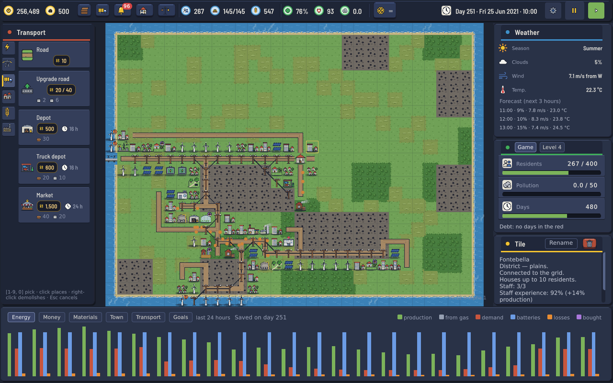
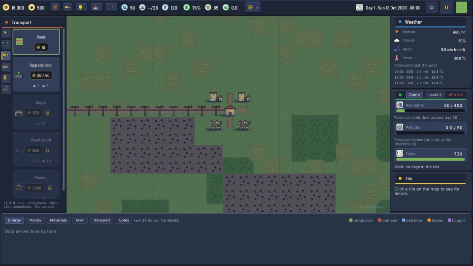

  

🇮🇹 [Italiano](README.it.md) · 🇬🇧 English · 🇩🇪 [Deutsch](README.de.md) · 🇫🇷 [Français](README.fr.md) · 🇪🇸 [Español](README.es.md)

# ⚡ Voltvale: Energy Grid Tycoon

**You run the power grid of a growing town.** Every hour the town needs energy: a little at night, a lot in the
evening. Build power plants, solar farms, wind farms and batteries, connect everything with power lines and
roads, find people to work in them, shift after shift, feed everyone, keep their homes warm in winter, move freight and
materials by truck without jamming the traffic, and grow your village to **400 residents within two game years**, without constant blackouts, without debt
and without choking it with pollution.

An original game by **Marco Scarlino**. Free to play. Official website: **[voltvale.it](https://voltvale.it/en/)**.

## Trailer

**[▶ Watch the trailer (1 minute)](https://scrnetto.github.io/voltvale/trailer/voltvale-trailer-en.mp4)** ·
also in [Italian](https://scrnetto.github.io/voltvale/trailer/voltvale-trailer-it.mp4),
[German](https://scrnetto.github.io/voltvale/trailer/voltvale-trailer-de.mp4),
[French](https://scrnetto.github.io/voltvale/trailer/voltvale-trailer-fr.mp4) and
[Spanish](https://scrnetto.github.io/voltvale/trailer/voltvale-trailer-es.mp4)

> **Status: in development (alpha).** You can play from start to finish, but a lot is still missing and some
> things may not work. Every report helps: see [Reporting a problem or an idea](#reporting-a-problem-or-an-idea).

## Play now in your browser

**[▶ Play Voltvale in your browser](https://scrnetto.github.io/voltvale/)**: nothing to
install. You need a recent browser (Chrome, Firefox, Edge, Safari) on a computer with a mouse and keyboard, or a
tablet: **tap = click, long press = right-click**. Click on the game before using the keyboard. Your saves stay in
the browser you use.
On a phone held **sideways** the game switches to a layout made for phones (still being tested: see
[Known issues](#known-issues)).

**Also on itch.io: [marcoscarlino.itch.io/voltvale](https://marcoscarlino.itch.io/voltvale)**, where you can play
in the browser, download the game for every system and leave a comment. Saves made in the browser on itch.io are
separate from those made here.

## Download the game

Every version is on the **[Releases](../../releases)** page and on
**[itch.io](https://marcoscarlino.itch.io/voltvale)**. Download the file for your system from the latest
version:

| System | File | How to start it |
|---|---|---|
| **Windows** 10/11 (64-bit) | `Voltvale-<version>-windows.zip` | Extract the zip and open `Voltvale.exe` |
| **macOS** 12 or later | `Voltvale-<version>-macos.zip` | Extract the zip and open `Voltvale.app` |
| **Linux** (64-bit) | `Voltvale-<version>-linux.zip` | Extract the zip and run `Voltvale` |
| **Android** 8 or later (tablet or phone) | `Voltvale-<version>-android.apk` | Open the file on the device and install it (see below) |

### First launch

The game isn't signed with a paid certificate, so your system may warn you that it comes from an unknown
developer. This is normal for independent games.

- **Windows**: if you see «Windows protected your PC», click **More info**, then **Run anyway**.
- **macOS**: if you see «cannot be opened because the developer cannot be verified», **right-click the app →
  Open**, then confirm with **Open**. You only need to do this once. If your Mac says the app «is damaged», open
  Terminal in the folder of the zip and type `xattr -cr Voltvale.app`.
- **Linux**: if it doesn't start, make the file executable with `chmod +x Voltvale`.
- **Android**: the game isn't on the Play Store. Download the `.apk` on the device and open it; Android asks you to
  allow installs from your browser or file manager the first time («Install unknown apps»). Play Protect may
  warn you about an unknown app: choose to install anyway. To update, install the new `.apk` over the old one.
  On a touch screen: **tap = click, long press = right-click**, two fingers to pan and pinch to zoom.

**Checking the download (optional).** Each version has a `SHA256SUMS.txt` file with the fingerprint of every zip.
On Linux run `sha256sum -c --ignore-missing SHA256SUMS.txt`, on macOS `shasum -a 256 -c SHA256SUMS.txt`.

### Requirements

- A screen of at least 1280×800, or a phone held sideways.
- Mouse and keyboard, or a touch screen (tablet or phone, web or Android version).
- About 200 MB of free space.
- Any graphics card from the last 10 years: built-in ones are fine too.

## How to play

The game opens with the **start menu**: **New game**, where you choose the town's name and the difficulty (see
[New game](#new-game)), or **Continue** to pick up your last save. The game starts on
**Sunday 18 October 2020** at 8 am and begins **paused**: press **Space** to start the clock. At 1× speed one game
hour lasts one second, and you can speed up to 2× and 4×. The seasons follow the calendar: you start in autumn, and in winter the
days are shorter and the sky is cloudier. The top bar shows the day of the game, the day of the week, the date and
the time, for example «Day 1 · Sun 18 Oct 2020 · 08:00».

- **Goal**: reach **400 residents** with pollution **below the limit** within **2 years**. After the victory you
  can **keep playing**, with no more time limit.
- **Defeat**: if your money stays in the red for **30 days in a row**, or if the 2 years run out before you win.
- **The town hall grows**: from **village** to **small town**, **town** and **city**, as you complete small goals.
  Each level unlocks new buildings: see [Town hall levels and goals](#town-hall-levels-and-goals).
- **Crews do the building**: a new building is first a **construction site**, and it works once a crew has finished
  the job. See [Construction sites and crews](#construction-sites-and-crews).
- **The grid**: every building must be connected to the **town hall**. **Power lines** start from the town hall
  and extend it, diagonals included. A building is connected if it touches the town hall, a line or another
  connected building: a group of buildings side by side is connected if one of them touches the grid.
- **Roads**: besides power, every building must touch, with one side, a **road connected to the town hall** (power
  lines don't need one). See [Roads and traffic](#roads-and-traffic).
- **Demand and energy**: the town uses little energy at night and a lot in the evening, around 7 pm. If there
  isn't enough, even with the energy bought from outside, there's a **blackout**: residents get angry and some leave.
- **Energy sources**:
  - the **sun** only produces by day, and little in winter or under clouds;
  - the **wind** changes strength and direction from hour to hour (the Weather panel shows where it blows from); a
    wind farm **downwind** of another one, a few tiles away, produces less (the turbines' «wake», up to 40% less);
  - **coal** produces day and night, but it pollutes, burns the coal dug up by the **mines** and changes output
    slowly, by at most a quarter of its capacity per hour;
  - **gas** only switches on when energy is short, for the evening peaks, but the gas comes from the mainland and
    costs money every hour.
- **Batteries** store the extra energy and give it back when needed, for example in the evening.
- **Energy from outside**: surplus energy is **sold**, and what's missing is **bought** at twice the price, through
  the **border line** next to the bridge; the more you sell in an hour, the less it's worth. See
  [Links to the mainland](#links-to-the-mainland).
- **Pollution**: coal power plants pollute and the air clears slowly. One power plant is fine, too many are not.
  It makes residents sick, and above the limit you can't win.
- **Growth**: the town grows if residents are **happy** enough, there's room in the **districts** and there's enough
  **food** in store.
- **Heating**: below 15 °C homes need **heat**, from wood-fired heating plants or from the districts' gas boilers.
  Cold homes make residents unhappy and sick. See [Heating, gas and fuel](#heating-gas-and-fuel).

### New game

**New game** (from the start menu or the pause menu) opens a screen where you choose:

- the **town's name**: the game suggests one, the dice button suggests another, or you type your own. The town
  hall takes the town's name;
- the **difficulty**: **easy** (starting money ×1.5, upkeep ×0.8), **normal** or **hard** (starting money ×0.7,
  upkeep ×1.2).

The «Disasters» and «Map size» options are already there, but for now disasters are off and there's only one map.

### Town hall levels and goals

The town hall grows with the town: **I village**, **II small town**, **III town**, **IV city**.

- Each level has **4 goals**, and each one you complete pays a **cash reward**:
  - to become a **small town**: 100 residents, 5 connected districts, 3 days without blackouts, happiness at least
    60%;
  - to become a **town**: 200 residents, a working sawmill, a depot, 20,000 in the bank;
  - to become a **city**: 400 residents, a hospital, pollution below 30, 7 days without blackouts.
- When every goal of the level is complete, the **Upgrade** button (the arrow icon at the top of the town hall's
  Tile panel) lights up. It costs money and materials (small town 3,000 and 40 timber; town 8,000, 80 timber and 60
  stone; city 15,000, 100 timber, 100 stone and 80 cement) and the work takes one to three days. The town hall never
  levels up by itself.
- Buildings **unlock** like this:

| Level | Buildings |
|---|---|
| **I village** | power lines, dirt roads, districts, solar farms, wind farms, coal power plants and mines, batteries, farms, parks |
| **II small town** | paved roads, depots, truck depots, sawmills, quarries, greenhouses, cold stores, fishing boats, gas power plants, wood-fired heating plants, Market, Workshop |
| **III town** | avenues, cement works, transformers, hospitals, pumped storage |
| **IV city** | nothing new for now: it's there for the buildings of upcoming updates |

- In the list, buildings that are still locked are greyed out with a **padlock**; hover over them to see the level
  they need. The **Market** can be built only once per town: after the first one it turns grey.
- The **Goals** panel has two tabs: **Game** (the final goal and the forecast) and **Level** (the goals of the level
  and how many you've completed). Some goals, such as happiness, are counted at midnight: the panel says «reached:
  counts at midnight».
- For traffic, the town hall counts as a paved road, and as an avenue from level III.

### Construction sites and crews

- When you place a building you pay straight away, and a **construction site** opens in its place. A **crew** sets
  off from the town hall, gets there and works for the hours the job needs; the building works once it's done.
- Every building has its own **build time**, shown in the list and in the tooltip next to the cost: for example 8
  hours for a park, 12 for a solar farm, 24 for a wind farm, 48 for a coal power plant or a hospital. Power lines and
  roads are still instant.
- Crews work **from 8 to 17**, every day. The town hall has **2**: if there are more sites, they **queue up** and wait
  for a free crew.
- The **Workshop** (Town tab, from level II) adds **2 crews** that set off from there: worth it when sites wait a long
  time in the queue, or are far from the town hall. It needs staff, power and a road.
- Crews gain **experience** in building, electrical and mechanical work: the more they work, the faster they get, up
  to 50% faster.
- Click a construction site to see in the Tile panel whether it's queued (and in which position), whether the crew
  is on its way or at work, and how many hours are left. The town hall's and the Workshop's Tile panels show their
  crews, what they're doing and their experience.
- A construction site can be demolished like a building, with half the cost refunded.

### Links to the mainland

The map is an **island**, joined to the mainland by a **bridge to the west**, level with the town hall.

- Next to the bridge are the **border line** and the **highway**, already connected to the town hall by a row of
  power lines and a dirt road. The bridge, the border line and the highway can't be demolished; the lines and the
  dirt road can, but without a link the town can't trade anything.
- **Power**: surplus energy is **sold**; what's missing is **bought** at twice the price, as long as there's money.
  So the game doesn't start in the dark while you wait for the first construction sites, but buying everything for
  long empties the coffers.
- Trading is limited by the line's **capacity**, which grows with the town hall's level:

| Town hall | Sell up to | Buy up to |
|---|---|---|
| I village | 40 MW | 20 MW |
| II small town | 60 MW | 30 MW |
| III town | 90 MW | 45 MW |
| IV city | 120 MW | 60 MW |

  At the evening peak of a big town, bought power isn't enough: you need your own power plants and batteries.
- The border line's Tile panel has the two switches **Sell** and **Buy**, the capacities, the buying price and how
  much was bought and sold in the last hour. With «Buy: off» the town has a blackout when production isn't enough.
- A **trade icon** above the border line shows when power was bought or sold in the last hour; the **Energy** chart
  shows the power bought.
- **Goods from outside**: imported food, copper and Market trades come through the **highway**, and only arrive if
  it's connected to the town's roads.

### Work and staff

Buildings need people to run them.

- About **56 %** of the residents work. The bar at the top shows how many people have a job out of the available
  workforce.
- **Coal power plants**, **coal mines**, **industries**, the **food** buildings, **hospitals**, **parks**, **cold
  stores**, **depots**, **Workshops**, **pumped storage**, **gas power plants** and **wood-fired heating plants** need staff. **Solar farms**, **wind farms**, **batteries**, power lines
  and transformers run by themselves.
- The **Tile** panel shows how many jobs are filled, for example **Staff: 4/4**, and how many people that takes,
  shifts included.
- With too few staff a building produces less; **with no staff at all it stops** and shows the **«no staff»**
  signal.
- Workers go **to energy first**, then **to food**, then **to hospitals and heating plants**, then **to industries**, then **to the mines**, then **to services** (districts and parks).
  Districts keep working even when their services are short of staff.
- **Unemployment** costs money: people without a job pay no income tax and get unemployment benefit from the town;
  if it's high, residents are less happy.

### Working hours and shifts

Every building with staff has its own working hours, shown in the **Tile** panel:

| Hours | Buildings | People per job |
|---|---|---|
| **Always open, 3 shifts (6, 14, 22)** | coal and gas power plants, wood-fired heating plants, coal mines, hospitals, cold stores, truck depots, pumped storage | about 4: one job covered day and night takes three shifts plus rest days |
| **Open 8–17, Monday to Friday** | sawmills, quarries, cement works, depots | 1 |
| **Open 8–17, every day** | farms, fishing boats, greenhouses, parks, Workshops, the services of the districts | about 1.4, for the days off |

- A coal power plant with all its jobs filled employs about **17 people**: plan your districts accordingly.
- **Outside its hours a building is closed**: it produces nothing and uses no power or materials. The Tile panel
  says when it reopens, for example «Closed: reopens Monday at 08:00». Workers keep their job while it's closed.
- Industries are closed **at the weekend**: plan your timber and cement stocks for Saturday and Sunday.
- Food buildings work every day, but only by day: farms, fishing boats and greenhouses produce from 8 to 17.

### Food

Residents eat every hour. The food stock is in the top bar, next to the ear of wheat, and turns red when it's
running low.

- **Farm** (plains): produces with the seasons, a lot in summer and **nothing in winter**.
- **Fishing boat** (coast): fishes all year round, but stops when the wind is too strong.
- **Greenhouse** (plains or hills): produces all year round, but **uses a lot of power**.
- **Cold store** (plains): raises how much food the town can keep.
- **Food runs on the grid**: food buildings use power. During a **blackout** they don't produce, and cold stores
  lose part of the extra food.
- **If the stock runs out**, food is imported automatically through the highway, but it's expensive. Imported food keeps the town from
  starving, but it **doesn't grow**: growth needs at least one day of its own stock.
- **If the money runs out too**, famine hits and residents leave.
- The **Tile** panel shows how much each building produced in the last hour (for example **Food: 5.4/h**), how much room a cold
  store adds, and how much power it uses.

### Happiness, health and taxes

- **Happiness** (the smiley in the top bar): it moves slowly towards a value that is the sum of a few factors,
  namely blackouts in the last 24 hours, food, hunger, cold homes, unemployment, pollution, health, parks, taxes and the household budget. Hover
  over the number to see where it's heading and how much each factor weighs, for example «Blackouts −5.0» or
  «Parks +3.0». Below 60 the town doesn't grow, and below 35 people start to leave.
- **Health** (the heart): drops with pollution, hunger and cold homes. **Sick people stay home**, so there are fewer workers,
  and an unhealthy town is also a less happy one.
- **Hospital** (plains): treats up to 250 residents, needs staff and uses power. It can't treat anyone during a
  blackout. A must if you go for coal.
- **Park** (plains or hills): makes people happier. It counts for more in a small town: each park is worth +3 per
  100 residents, up to +10.
- **Taxes**: income tax on the wages of people who work, in three levels, low, normal and high, with the coin button
  in the top bar or the **T** key. High taxes bring in more money but less happiness; low taxes do the opposite.

### Wages, households and bills

- The town pays a **wage** for every job that's filled, a little more for night shifts.
- Staff gain **experience**: people who stay in the same job produce up to **15%** more, but they also earn more.
  When the staff change, experience drops: keeping your workers pays off. The Tile panel shows the experience and
  wages of every building.
- Households pay the town **income tax**, the **electricity bill** of the districts, **food** and **rent**. People
  without a job get **unemployment benefit**. Households also have other income, such as pensions and work outside
  town.
- **Households** panel (**H** key or the button at the top): household income and spending over the last 24 hours,
  what's left for each resident per day and the average wage. This is where you set the **energy tariff**: low,
  normal or high. A high tariff brings the town more money but leaves households with less.
- What's left for households affects happiness («Household budget» in the happiness tooltip).

### Heating, gas and fuel

- **Heat**: when the temperature drops below **15 °C**, homes need heat, more the colder it is and the more residents
  there are. The game starts in autumn, so you need it from the very first nights; in summer you don't.
- Heat comes first from **wood-fired heating plants**, then from the **gas boilers** of the districts. You don't
  build the boilers: they're already there and buy gas from the mainland.
- **Cold homes**: the heat that's missing takes up to 20 points of **happiness** («Cold homes» in the happiness
  tooltip) and makes **health** worse. Districts in the cold show a snowflake, and the «Cold homes» warning appears
  above the map and in the event log.
- Households pay the town a **heating bill**, with the energy tariff you've chosen. In the **Households** panel the
  **Gas heating** switch turns the gas boilers off: you save gas, but homes stay cold.
- **Wood-fired heating plant** (Town tab, from level II): at full power it gives 15 units of heat per hour and burns
  3.75 timber, which trucks bring to its silo. It costs 800 and 20 cement, takes 20 hours to build, is always open
  and needs staff and power. Without timber it stops. The timber it burns is timber you won't build with or sell.
- **Gas power plant** (Energy tab, from level II): 15 MW, it costs 900 and 30 cement and takes 24 hours to build. It
  switches on **only when energy is short**: after the batteries and before power is bought. It doesn't produce to
  sell. At full power it burns 42 gas per hour, and it pollutes less than coal.
- **Gas and fuel** are bought hour by hour, only as much as needed, through the **highway**, as long as there's
  money: gas costs 1.20 a unit, fuel 6, less with a Market in town. The Market panel shows today's prices.
- **Gas crisis**: once every winter, between mid-November and the end of January (never in the first two months of a
  game), for two or three weeks gas costs **2.5 times** as much and fuel 1.5 times. The «Gas tensions» warning
  arrives three days before. During the crisis households pay half of the extra heating cost and the town pays the
  other half, and buying power is often cheaper than running the gas power plant.
- **Coal is slow**: a coal power plant changes its output by at most a quarter of its capacity per hour, so a new one
  takes 4 hours to reach full power. When the grid has nowhere to put the energy (batteries full, sales at the
  limit), it turns down and burns less coal, but then it can't climb back fast for the evening peak. The Tile panel
  says whether it's ramping up or down.

### Materials and industries

Most buildings cost **materials** as well as money: **timber** and **cement**. The list on the left shows them
under the price, with small icons; hover over the button to read them in full.

- **Sawmill** (only in the **woods**, the dark green tiles): 7.5 timber per hour.
- **Quarry** (hills): 7.5 stone per hour.
- **Cement works** (plains): turns 7.5 stone into 7.5 cement per hour, and uses a lot of power. Without stone it
  stops, and stops using power too.
- Industries work **from 8 to 17, Monday to Friday** (see [Working hours and shifts](#working-hours-and-shifts)).
- Industries need **staff** and **power**. Workers go to them after energy, food and hospitals, and before the
  coal mines.
- **If you don't have enough materials** when you build, the missing part is bought from outside straight away
  (timber 10, cement 22 each). You can play without industries, but it costs more.
- You start with 200 timber and 200 cement.
- The **Stocks** button, next to coal in the top bar, opens a small panel with coal, timber, stone, cement and
  food, and how much comes in and goes out each hour (timber burned by heating plants included). Click outside it or press **Esc** to close it.
- The **Tile** panel shows what an industry produces and uses, and «stopped: no stone» when it has run out.

### Roads and traffic

- Every building except power lines must touch, with one side, a **road connected to the town hall**. Without one
  it stops and shows the «no road» signal. You start with four dirt roads around the town hall and one to the
  highway.
- **Road** tool (**R** key, or the first button of the list): click or drag to lay **dirt roads**. A road can run
  under a power line, but not under other buildings.
- **Upgrade road** tool (**M** key): **dirt road → paved road** (from level II) **→ avenue** (from level III).
  Each level carries more traffic and is
  faster, but costs cement. After an upgrade the tile stays **under construction** for a few hours, with less room
  for traffic.
- **Commuters**: workers travel from the districts to work when their hours start and go home when they end:
  around 8 and 17 for most buildings, and at 6, 14 and 22 for the shifts of buildings that are always open. At the
  weekend industries are closed and the roads are quieter. If the roads are full, everyone slows down: late workers produce less, and the previous day's delays cost **happiness**
  («Commuter traffic» in the happiness tooltip).
- **Avenues** carry a lot of traffic but are **noisy**: they take a little happiness from the districts next to them.
- **Traffic map** (**G** key): colours the roads by how busy they are.
- **Transport** panel (**J** key or the truck button at the top): people and freight on the move, average travel
  time, trucks in use, the **busiest roads** (click one to see it in the Tile panel) and the last 24 hours.
- To demolish a road: right-click, as for buildings (half the cost refunded).

### Freight and trucks

- Producers (mines, sawmills, quarries, cement works, farms, fishing boats, greenhouses) put their goods in their
  **yard**. **Trucks** take them to the town hall or the nearest **depot**, and from there to the **silos** of
  whoever uses them: coal power plants, the cement works and wood-fired heating plants. The cold store works as the
  depot for food.
- The town hall has **2 trucks**; each **truck depot** adds **3** (it needs staff and power). Better roads and less
  traffic let the same trucks carry more.
- If there aren't enough trucks you get the «**Not enough trucks**» warning: yards fill up and producers stop
  («stopped: yard full»). Build a truck depot, or a depot closer by.
- A yard only holds so much: a busy sawmill, quarry or cement works can fill it before evening if the trucks don't
  keep up.
- **Food spoils** a little on every trip: the farther the farm, the more you lose.
- **Trucks burn fuel**, bought hour by hour through the highway: the more they drive, the more it costs. With no money
  or with the highway cut off, the whole fleet stops («Trucks stopped: no fuel»).
- The **Tile** panel shows yard, silo and distance from the depot; **Stocks** shows what is waiting in the yards.

### Market

- Build the **Market** from the **Transport** tab of the list, from level II; there's one per town. It needs a road
  and staff, and it's open 8–17 on weekdays. Trades go through the **highway**: if it isn't connected, the Market
  neither buys nor sells.
- With the Market you buy materials and food **without the import surcharge**, and you can buy **coal and stone**
  too. Whatever you don't need you can **sell** at 70% of the purchase price.
- **Market** panel (**K** key or the scales button at the top): stock and prices for every material; the
  **«Sell above»** and **«Buy below»** thresholds make the Market trade by itself, hour by hour; the **«Buy 10»** and
  **«Sell 10»** buttons work straight away, even outside opening hours.
- Sales and purchases show up in the event log and in the **Money** tab of the chart.
- The **Imported fuels** box shows today's prices of gas and fuel, even before you build a Market. With a Market in
  town they cost less, without the import surcharge. They can't be stored or sold.

### Line losses

- A power plant's energy is partly lost along the lines on the way to the nearest **node**: the **town hall** or a
  **transformer** (built from the list). The farther the plant, the more it loses; the Tile panel shows how much.
- **Upgrade line** tool (**L** key): lines go from level **I** to **II** and **III** and lose less, but cost
  **copper**, which is bought from outside and arrives through the highway.
- The **Energy** chart at the bottom has a bar for losses.

### Mines and lakes

- Every coal deposit has its own **reserve**, different from tile to tile: a mine's Tile panel shows how much is
  left and for how many days. When it's nearly empty the mine produces less; you get the «mine nearly exhausted»
  and «mine exhausted» warnings.
- Three days after it runs out, the mine disappears and a **lake** takes its place. A lake:
  - cools nearby **coal power plants**, which produce a little more;
  - pleases the **districts** next to it, like a park;
  - can host **fishing boats**;
  - allows **pumped storage**, a big battery that can only be built next to a lake.

### Names

- Streets, districts, hospitals and parks have a **name**, shown at the top of the Tile panel, for example
  «Volta Street» or «Valfiora». A street keeps the same name along its whole straight stretch.
- The **Rename** button in the Tile panel changes it; leave it empty to go back to the automatic name.

### Event log

- The **bell** at the top counts new events; it turns red when one is serious.
- The **Events** panel (**E** key or the bell) shows the **current problems** at the top: debt, buildings that are
  not connected or have no staff or no road, full yards, mines running out, imported food. Below is the **log** of
  what happened, with filters by type.
- Click a line to centre the map on the spot and open the Tile panel.

### Goal forecast

- The **Goals** panel tells you how the game will go **under current conditions, with no new buildings**: around
  which day you'll reach 400 residents, whether pollution will stay below the limit, or whether you'll end up in
  debt.
- The outlook is **on track**, **at risk** or **off track**. The forecast is updated every day and after every
  building, demolition or change of taxes and tariff.
- The **Goals** tab of the chart shows residents and pollution since the start of the game, the goal line and the
  forecast as a dashed line.

### Charts

The panel at the bottom has six tabs. The first five show the **last 24 hours**, one column per hour; the sixth,
**Goals**, shows the whole game with the forecast. Click a tab to switch (the game remembers your choice), and hover
over a column to read the exact values of that hour.

- **Energy**: production, demand, batteries, line losses, power bought and power from gas.
- **Money**: income above zero, spending below, and the balance, with sales and purchases at the Market and the gas
  bought.
- **Materials**: how much of each material is produced and used, and the stock; pick the material with the buttons next to the chart.
- **Town**: food produced and food eaten, the food stock, happiness and health, heat needed and heat supplied.
- **Transport**: people going to work and going home, trucks on the road, and how loaded the roads are.
- **Goals**: residents and pollution since the start of the game, the goal line and the forecast as a dashed line
  (see [Goal forecast](#goal-forecast)).

After loading a save from an earlier version the charts start empty and fill up hour by hour.

### Controls

Hover over any icon or button: a tooltip explains what it is. Hover over a building on the map to see its status
and how much energy it produces or uses.

| Control | What it does |
|---|---|
| Keys **1–9** and **0** | Pick what to build: Power line, Coal mine, Coal power plant, Solar farm, Wind farm, Battery, District, Farm, Fishing boat, Greenhouse. The other buildings (cold store, park, hospital, industries, depots, transformer, pumped storage, Market, Workshop) are in the list on the left, in six tabs: Energy, Grid, Transport, Town, Food, Industry |
| **Left click** | Places the chosen building. With nothing chosen, selects a tile and shows its details |
| **Right click** (on a tablet: long press) | With a building chosen, cancels the choice. With nothing chosen, asks to confirm demolition (half the cost refunded) |
| **Esc** | Cancels the choice; if there's nothing to cancel, opens the **pause menu** (Resume, Save as…, Quick save, Load game, Save and quit to menu, New game, Settings) |
| **⚙** button (at the top) | Opens the pause menu, like Esc: saves, settings, quit |
| **F11** | Full screen / window |
| **Space** or the ▶/❚❚ button | Pause / resume |
| **F** or the speed button | Speed 1× → 2× → 4× → 1× |
| **V** | Advance by a single hour |
| **T** or the coin button | Low, normal, high taxes |
| **Click and drag** with the left button, **WASD** or **arrow keys**, middle mouse button | Move the view |
| **Mouse wheel** | Zoom |
| **Stocks** button (at the top) | Shows the stocks of coal, timber, stone, cement and food |
| **F5** / **F9** | Quick save / load the quick save |
| **R** | **Road** tool: click or drag to lay dirt roads |
| **M** | **Upgrade road** tool: dirt road → paved road → avenue |
| **L** | **Upgrade line** tool: lines from level I → II → III |
| **G** | Traffic map |
| **J** or the **Transport** button (at the top) | Transport panel: people, freight, busiest roads |
| **E** or the bell (at the top) | Event log: current problems and what happened |
| **H** or the **Households** button (at the top) | Households panel: wages, spending, energy tariff |
| **K** or the scales button (at the top) | Market panel: buy and sell materials and food |
| **Rename** button (in the Tile panel) | Renames a street, district, hospital or park |
| **Demolish** button (icon in the Tile panel) | Demolishes the selected building or construction site (half the cost refunded) |
| **Upgrade** button (icon in the town hall's Tile panel) | Raises the town hall to the next level, once the goals of the level are complete |
| **Sell** and **Buy** buttons (in the border line's Tile panel) | Switch automatic selling and buying of power on and off |
| **Gas heating** button (in the Households panel) | Switches the districts' gas boilers on and off |
| Tabs of the chart (at the bottom) | Energy, Money, Materials, Town, Transport, Goals |

### Languages

The game is in **Italian, English, German, French and Spanish**. Pick **Language** in the **Settings** (start menu or
pause menu) to switch at any time, without restarting; your choice is remembered. On first launch the game uses your
system language if it's one of these five, and English otherwise. In the web version you can open a language
straight away by adding `?lingua=en` (or `it`, `de`, `fr`, `es`) to the address.

### Settings

From the start menu or the pause menu (**⚙** or **Esc**), choose **Settings**. Each click on an item moves to the
next value, and your choices are remembered.

- **Fullscreen** (not in the web and Android versions) and **Language**.
- **Autosave**: every day, every 3 days, every 7 days, or off.
- **Interface size**: 90, 100 or 110%.
- **Layout**: automatic, computer or phone.
- **Animations**: on or off. Off stops the moving traffic, clouds, smoke and the other effects: handy on slow
  computers.
- **Music** and **Sound effects**: 100, 75, 50 or 25%, or off.

### On a phone

On a phone held **sideways** the game uses a layout made for small screens:

- the map fills the screen and the top bar is short; tap the values to open the **Town** sheet with happiness,
  health and taxes;
- the building **categories** are at the bottom: tap one to open its grid, then tap a building to see its card with
  the description and the **Build** button;
- the panels (Tile, Weather, Goals, charts and the others) slide up from the bottom; tap a column of a chart to read
  its values.

The layout is picked automatically; you can switch between phone and computer in the Settings.

### Music and a living map

- **Music**: one piece for the day, one for the night and a theme with choirs for the start menu; between day and
  night the music changes at the end of the piece. **Sound effects** for placing, roads, demolition, blackouts,
  clicks and panels. Set the volume in the Settings.
- **The map moves**: traffic dots on the roads (with headlights in the evening), cloud shadows carried by the wind,
  building shadows that follow the sun, glittering water and waves in the wind, turbines that spin faster in a strong
  wind, smoke only from buildings at work and drifting with the wind, haze near polluters, reflections on solar farms
  at noon, snow when it's cold.
- The values in the top bar light up, with an arrow, when they go up or down.

### Signals on buildings

- **Unplugged plug** (white and red circle): the building isn't connected to the grid.
- **Crossed-out lightning bolt** (yellow circle): it's connected but gets no power (blackout), or a coal power
  plant has stopped because the coal has run out. A greenhouse or cold store with no power doesn't work.
- **Crossed-out hard hat** (light-blue circle): **no staff**, so the building has stopped. Build more districts or
  free up workers.
- **Broken road** (orange circle): **no road**, no road connected to the town hall reaches it.
- **Stack of crates** (purple circle): **yard full**, the trucks can't keep up with the goods.
- **Mine boarded up**: the mine is **exhausted** and will become a lake in a few days.
- **Construction site**: the building is still being built; it works once the crew has finished.
- **Trade icon** above the border line: the town bought or sold power in the last hour.
- **Crossed-out flame**: a gas power plant has stopped because **no gas** is arriving (highway cut off or no money).
- **Snowflake**: **cold homes**, the district isn't getting all the heat it needs.
- **Crossed-out jerrycan**: **no fuel**, the trucks of this truck depot are stopped.
- **Lights at night**: after dark, districts and the town hall switch their lights on. A building with no power
  stays dark, so a dark district at night is a warning.

### Tips for your first game

1. Pause and look at the map: **hills** are good for wind farms, and the dark **coal deposits** are where mines go.
   To the west is the **bridge**: power and goods from outside come through it.
2. Run a **power line** from the town hall towards where you want to build, with a **road** (**R** key) next to it:
   every building must touch one.
3. At the start the town **buys its power** from outside, at twice the price: put down some **solar and wind** and a
   **battery** for the evening right away. Construction takes hours, and the town hall's two crews do two jobs at a
   time.
4. Don't build too many coal power plants at once: each one needs about **17 people** on three shifts, and the
   town is still small. Solar and wind farms need no staff.
5. Build **districts** as long as production keeps up with demand.
6. Put down a **farm** early and plan for winter: farms stop in winter, so you need a stock and, from level II, a
   fishing boat or a greenhouse.
7. Open the **Goals** panel, **Level** tab, and press **Upgrade** as soon as you can: level II brings sawmills,
   quarries, depots, the Market and the Workshop.
8. From level II, put a **sawmill** in the woods and a **quarry** on a hill; from level III add a **cement works**.
   Buying materials from outside every time adds up. Industries rest at the weekend: keep a stock.
9. An early **park** lifts happiness while the town is small. If you build coal power plants, plan a **hospital**
   once you reach level III.
10. Keep an eye on the **Energy** chart at the bottom: if the red line (demand) goes above the green one
    (production), you're buying power or a blackout is coming.
11. When construction sites wait a long time in the queue, build a **Workshop**.
12. When «Not enough trucks» shows up, build a **truck depot**. As the town grows, check the **traffic map** (G)
    and upgrade the busiest roads (M); don't put avenues right next to districts.
13. Keep power plants close to the town hall or a **transformer**: far away they lose energy.
14. When the **bell** turns red, open the **event log** (E): the problems to fix are at the top, and a click takes
    you there.
15. Check the **forecast** in the Goals panel: if it says «off track», the game won't be won as things stand.
16. When your industries make more than you use, a **Market** sells the surplus and lets you buy materials for less.
17. Space out your **wind farms** along the wind direction (Weather panel): one behind the other, they steal each
    other's wind.
18. Coal is slow: a new coal power plant takes 4 hours to reach full power, and it can't follow the evening peak by
    itself. From level II a **gas power plant** covers the peaks, but every hour of gas costs money.
19. Before winter, think about **heating**: a **wood-fired heating plant** next to a sawmill saves a lot of gas. When
    the «Gas tensions» warning arrives, you have three days to get ready for the crisis.

## Saves

- **Save as…** (pause menu): choose a name for the save, or overwrite one you've already made. Up to 50 named saves
  per game.
- **Quick save**: **F5** saves, **F9** goes back to it. There is one per game and it is overwritten each time. On a
  tablet it's in the pause menu.
- **Autosaves**: at the start of every game day, or every 3 or 7 days, or never (Settings); the last three are
  kept.
- **Load game** (start menu and pause menu): all your saves, grouped by game, with day, money, residents and date.
  From here you can **load**, **rename** a named save or **delete** one.
- **Continue** (start menu) resumes the most recent save of any kind.

## Where saves are stored

Saves stay on your computer, or in your browser for the web version, and the game sends nothing over the
internet.

- **Windows**: `%USERPROFILE%\AppData\LocalLow\Marco Scarlino\Voltvale\salvataggi`
- **macOS**: `~/Library/Application Support/Marco Scarlino/Voltvale/salvataggi`
- **Linux**: `~/.config/unity3d/Marco Scarlino/Voltvale/salvataggi`
- **Android**: inside the app; they are deleted if you uninstall it.

**Coming from an earlier version?** The first time you start version 0.3.0, the game **copies** your saves from
the old «Energy Grid Tycoon» folder (same path, with «Energy Grid Tycoon» instead of «Voltvale»). The old folder
stays where it is. You'll need to choose your **language** again once.

**From 0.4.0** saves use a new format. Saves from earlier versions still load: the town restarts with the
starting food stock. A 0.4.0 save doesn't open in earlier versions.

**From 0.5.0** the format changes again: taxes and health. Saves from earlier versions load with normal taxes and
the starting health. A 0.5.0 save doesn't open in earlier versions.

**From 0.6.0** the format changes again: materials. Saves from earlier versions load with the starting timber and
cement, and the map gains its woods; buildings that end up in the woods stay where they are. A 0.6.0 save doesn't
open in earlier versions.

**From 0.7.0** saves live in one folder per game. The first time you start it, the game turns the saves of the
previous version (the save and the autosave) into one game, which you'll find in **Load game** and with
**Continue**; the original files stay in the `vecchi` subfolder. Earlier versions don't see 0.7.0 saves.

**From 0.8.0** the format changes again: roads, freight, traffic, lines, mines and names. Saves from earlier
versions still load: the game lays the dirt roads around the town hall and a dirt road to every building by itself;
coal power plants restart with a full silo, mines with a full reserve, and streets, districts, hospitals and parks
get a name. A 0.8.0 save doesn't open in earlier versions.

**0.9.0** uses the same save format as 0.8.0: your 0.8.0 games carry on as they are, with the new working
hours.

**From 0.10.0** the format changes again: event log, wages, households, Market and forecast. Saves from earlier
versions still load: the event log starts empty, the tariff is normal, staff start again with no experience and the
Goals chart begins on the day you pick the game up again. A 0.10.0 save doesn't open in earlier versions.

**From 0.11.0** the format changes again: town hall levels, construction sites and links to the mainland. Saves
from earlier versions still load: the town hall starts at the lowest level that covers everything you've already
built, and the map gains the bridge, the highway and the border line, connected to the town. A 0.11.0 save doesn't
open in earlier versions.

**From 0.12.0** the format changes again: heating, gas and fuel. Saves from earlier versions still load: gas
heating starts switched on and coal power plants carry on from the output they had. A 0.12.0 save doesn't open in
earlier versions.

Saves from one alpha version might not work with the next one: the [changelog](CHANGELOG.md) says so when it
happens.

## Coming next

What's already planned, roughly in this order. Plans may change.

- **Water and waste**: waterworks, treatment plants and landfills for a bigger town.
- **Education**: schools, and better-trained workers.
- **Research**: technologies to discover that unlock new buildings, such as oil and gas extraction.
- **Wear and repairs**: buildings wear out and crews repair them with the materials you have; then strikes and
  emergencies, for those who choose them.
- **New maps**: maps of different sizes, a different map every game, rivers and bridges, and a minimap.
- **Later on**: several towns linked together and an isometric view.

## Known issues

- The **Windows** and **macOS** versions haven't been tested on real computers yet: if something goes wrong,
  [let us know](#reporting-a-problem-or-an-idea).
- The **Android** version is installed by hand, outside the Play Store.
- The **phone** layout is new: so far it has only been tried on simulated screens, not yet on real phones or in a
  phone's browser. If something doesn't work, [let us know](#reporting-a-problem-or-an-idea).
- In the **web** version saves live in your browser: if you clear the site's data, you lose them.
- It's an **alpha**: the game's balance (costs, production, growth, traffic) still changes from one version to
  the next. Industries produce a lot in a few hours: if their yards fill up, build a truck depot early.
- The German, French and Spanish translations haven't been reviewed by a native speaker yet: reports of
  mistakes are welcome.

## Versions

Versions follow [semantic versioning](https://semver.org/) in three stages:

| Stage | Example | What it means |
|---|---|---|
| **Alpha** | `0.3.0-alpha.1` | The game changes a lot between versions; parts are missing; there may be bugs and saves that don't carry over |
| **Beta** | `0.9.0-beta.1` | All the main parts are there; bugs and game balance are being polished |
| **Stable** | `1.0.0` | The first complete version. Then `1.0.1` for fixes and `1.1.0` for new features |

Alpha and beta versions are marked on GitHub as **pre-releases**. What changes in each version is in the
**[CHANGELOG](CHANGELOG.md)** and on each release page.

## Reporting a problem or an idea

Open a report on the **[Issues](../../issues/new/choose)** page and choose:
- **Problema** (problem): something doesn't work. Say what you were doing, what you expected and which version of the game
  you have.
- **Idea**: a suggestion to improve the game.

You need a GitHub account, which is free. If you don't have one, feel free to write to Marco directly.

## Licence

Voltvale is **free**: you can download it and play as much as you like. You may **not** redistribute, sell or
modify it: to let someone else play, send them the link to this page. The details are in [LICENSE.md](LICENSE.md)
(in Italian, with a summary in English).

## Credits

Designed and made by **Marco Scarlino**, with Unity and with the help of AI tools for code, graphics and
translations.

Fonts: Barlow Semi Condensed (SIL Open Font License 1.1), DejaVu Sans (Bitstream Vera license).

Music and sound effects are synthesised note by note by a program written for the game: no third-party samples, and
no music generated with artificial intelligence.
